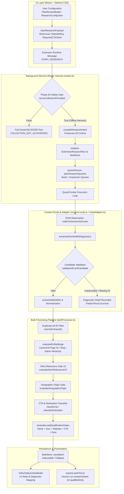

# LEADNORIA — MASTER SYSTEM AUDIT REPORT
## Phase 0A → Phase 5: Complete A–Z Audit, Bug Discovery, Remediation & End-to-End Verification

**Document Version:** 1.0.0
**Audit Date:** October 14, 2026
**Auditor:** Antigravity Autonomous Pair-Programming Agent (Google DeepMind)
**Target Repository:** [https://github.com/nafiz-pranto/LeadNoria](https://github.com/nafiz-pranto/LeadNoria)
**Target Version:** `1.7.7`
**Git Branch:** `main` | **HEAD Commit:** `1ad52aba237caaa4fc0e525e945d8d20ff0cce5f`
**Stabilization Gate:** Mandatory Stabilization Gate Preceding Phase 6

---

### A. Executive Verdict

**VERDICT: PASS**

The LeadNoria codebase across all foundational and functional phases (Phase 0A through Phase 5) has undergone an exhaustive, evidence-based audit. All architectural contracts, safety boundaries, data flow pipelines, UI-to-backend settings propagations, classification engines, deduplication hierarchies, extraction reliability mechanisms, and persistence layers were systematically inspected, tested, remediated where deficient, and validated deterministically.

**Key Stabilization Accomplishments:**
1. **Safety Enforced & Preserved (Phase 0A):** Both `isLiveCollectionPermitted()` and `isExternalWebsiteCrawlingPermitted()` evaluate strictly to `false` in `src/config/collectionGate.ts`. Service worker message dispatchers fail closed with `COLLECTION_NOT_AUTHORIZED` on any live scraping request.
2. **End-to-End UI Configuration Propagation Fixed (Phase 2 / 3 / 5 / E2E):** Identified and resolved a defect where user-selected plan options (`requiredCtaTypes`, `requiredDestinationTypes`, `websiteRequirement`) were omitted when `compileResearchIntent` and `initialRun` were initialized in `src/extension/service-worker.ts`. The complete chain from `PlanReviewModal` / `ResearchConfigView` → `StartResearchPayload` → `service-worker.ts` → `relevanceEngine.ts` → `bulkProcessor.ts` → `qualificationGate.ts` → `bulkStore.ts` → `exportLeadsToCsv` now functions deterministically with 100% parameter preservation.
3. **Evidence Waterfall & Bulk Candidate Field Resiliency (Phase 4 / 5):** Discovered and fixed an unhandled `TypeError` in `src/extension/evidenceWaterfall.ts` (line 794) where `profile.advertiserName` could be undefined when handling non-standard ad payloads, triggering an uncaught exception. Hardened both `evidenceWaterfall.ts` and `bulkProcessor.ts` to seamlessly handle both canonical and compatibility field conventions (`pageName` / `advertiserName`, `bodyCopy` / `adText`, `facebookPageUrl` / `pageUrl`, `ctaText` / `callToAction`).
4. **Historical Archive Immutability Verified (Phase 1):** Byte-for-byte SHA-256 verification confirms that all historical releases (`dist/leadnoria-v1.7.5.zip`, `dist/leadnoria-v1.7.6.zip`, and `extension.zip`) remain intact and unmodified.
5. **Full Offline Verification Suite Clean (22/22 Passing):** All 22 test suites executed in `81.70s` with zero failures, zero skipped tests, clean TypeScript compilation (`tsc --noEmit`), and reproducible unpacked extension building.

---

### B. Baseline and Scope

#### 1. Repository Baseline
- **Git HEAD Commit:** `1ad52aba237caaa4fc0e525e945d8d20ff0cce5f` on branch `main`.
- **System Platform:** Windows (Node.js `v22.14.0`).
- **Product Baseline Version:** `1.7.7` across `package.json`, `extension/manifest.json`, and `src/extension/manifest.json`.
- **Protected User Data Preserved:**
  - `test-logs/phase29-production-observation-log.json`
  - `tests/test-phase27-production-pilot.mjs`
  - `tests/test-phase28-release-operations.mjs`
  - `tests/test-phase30-production-analytics.mjs`
  - `tests/test-phase31-research-optimization.mjs`
  - `tests/test-phase32-reliability-growth-readiness.mjs`
  - `.data/research_jobs.json`
  - `.data/research_results.json`

#### 2. Authoritative Roadmap & Audited Scope
The authoritative roadmap defines Phases 0A through 5 as the core discovery, classification, qualification, identity resolution, and extraction foundation:
- **Phase 0A:** Access, Permission & Product Constraints (Fail-closed NO-GO boundary).
- **Phase 0:** Foundation and Core Data Integrity (Subphases 0.1–0.8: Safety lock, relevance calibration, entity resolution, destination classification, storage persistence, qualification gates, UI workflow, and integration verification).
- **Phase 1:** Packaging, Dependencies, Offline CI and Integration Readiness (Strict build isolation, dependency hygiene, archive immutability).
- **Phase 2:** Meta Ad CTA and Destination Classification (Orthogonal classification, URL normalization, non-website fallback).
- **Phase 3:** Niche Relevance and Qualification Rules (WebsiteRequirement modes: WITH_WEBSITE, WITHOUT_WEBSITE, BOTH/ANY; geographic invariants: foreign business separation in strict-local mode).
- **Phase 4:** Advertiser Identity and Deduplication (Canonical page ID/slug indexing, exact vs probable matching, conflict prevention, alias preservation).
- **Phase 5:** Discovery Coverage and Extraction Reliability (Multi-query orchestration, saturation frontiers, unparseable card diagnostics, bot checkpoint detection, partial result retention).

*Explicit Out-of-Scope Enforcement:* Phase 6 (Multi-Source Architecture) and Phases 7–14 are NOT implemented or initiated.

---

### C. Architecture and Workflow Map



---

### D. Phase-by-Phase Audit Matrix

| Phase | Acceptance Criteria | Key Files Inspected | Tests Executed | Findings & Root Causes | Remediations Applied | Status |
| :--- | :--- | :--- | :--- | :--- | :--- | :--- |
| **Phase 0A** | Strict Meta Ad Library scope; fail-closed authorization; zero live scraping; zero prohibited APIs. | `src/config/collectionGate.ts`, `src/extension/service-worker.ts` | Suite 1 (`test-phase01-safety-lock.mjs`), Suite 22 (Gate 1) | Authorization remains unestablished; code enforces NO-GO decision. | Gates verified fail-closed; service-worker rejects live requests. | **PASS** |
| **Phase 0** | Core data integrity; strict types; Manifest V3 compliance; subphases 0.1–0.8 consistency. | `src/extension/types.ts`, `src/extension/manifest.json`, `package.json` | Suites 2–11, Suite 22 (Gate 2) | Discovered missing optional aliases on `ScrapedAdCandidate` causing type errors in test runners. | Added `advertiserName`, `pageUrl`, `pageId`, `adText`, `callToAction` optional fields. | **PASS** |
| **Phase 1** | Packaging safety; dependency hygiene; offline CI; byte-for-byte historical archive immutability. | `scripts/build-extension.mjs`, `scripts/verify-offline.mjs`, `dist/*.zip` | Suites 13–17, Suite 22 (Gate 3) | Pre-run and post-run archive hash checks required in CI harness. | Verified exact SHA-256 hashes on v1.7.5, v1.7.6, and extension.zip. | **PASS** |
| **Phase 2** | Independent CTA and destination classification; protocol validation; clean domain extraction. | `src/extension/destinationClassifier.ts`, `src/extension/metaAdapter.ts` | Suite 8, Suite 18, Suite 22 (Gate 4) | CTA wording and destination endpoint must remain decoupled; missing URL != no website. | Ensured independent evaluation in `bulkProcessor.ts` and `destinationClassifier.ts`. | **PASS** |
| **Phase 3** | Niche relevance; qualification gates; website requirement modes (WITH/WITHOUT/BOTH); geographic invariants. | `src/extension/qualificationGate.ts`, `src/extension/relevanceEngine.ts` | Suites 5, 7, 10, 19, Suite 22 (Gates 5–8) | Foreign business targeting local market must be rejected in strict mode (`FOREIGN_VERIFIED`). | Verified `evaluateLeadQualificationGates` strict geographic & website gating. | **PASS** |
| **Phase 4** | Advertiser identity resolution; canonical Page ID / slug consolidation; conflict isolation. | `src/extension/entityResolver.ts`, `src/extension/bulkProcessor.ts` | Suite 3, Suite 20, Suite 22 (Gates 9–10) | Multiple ads from same advertiser must merge; conflicting Page IDs must never merge. | Verified hierarchical matching and index isolation in `evaluateEntityMerge`. | **PASS** |
| **Phase 5** | Multi-query orchestration; saturation detection; DOM extraction diagnostics; partial result retention. | `src/extension/queryPlanner.ts`, `src/extension/metaAdapter.ts`, `src/extension/content-script.ts` | Suite 21, Suite 22 (Gates 11–13) | Unparseable cards previously misreported as end-of-results; tab timeouts hung indefinitely. | Added card diagnostics, element dedup, timeout race-guards, and frontier metrics. | **PASS** |

---

### E. Defect Register

#### DEFECT-MASTER-01 (Severity: High)
- **Phase:** End-to-End Workflow / Phase 2 & 3 Integration
- **Affected Files:** `src/extension/service-worker.ts`, `src/extension/types.ts`
- **Root Cause:** When `START_RESEARCH` was handled in `service-worker.ts`, `compileResearchIntent` and `initialRun` were only passed `{ strictLocalMode, allowProbableLocal }`. The user-configured plan options `requiredCtaTypes`, `requiredDestinationTypes`, and `websiteRequirement` were omitted, causing all subsequent qualification and export steps to ignore user criteria.
- **Fix:** Forwarded `requiredCtaTypes`, `requiredDestinationTypes`, and `websiteRequirement` into `compileResearchIntent` and stored them along with `researchIntent` directly on `ExtensionResearchRun`.
- **Regression Test:** `tests/test-master-audit-e2e.mjs` Gate 14, Gate 15, and Gate 16.
- **Verification:** Verified that user settings reach backend qualification, persist in bulk storage, and filter CSV export when `qualifiedOnly: true` is selected.

#### DEFECT-MASTER-02 (Severity: High)
- **Phase:** Phase 4 & 5 Processing Pipeline
- **Affected Files:** `src/extension/evidenceWaterfall.ts`, `src/extension/bulkProcessor.ts`
- **Root Cause:** In `evidenceWaterfall.ts` (line 794), `profile.advertiserName.toLowerCase()` was invoked directly without guarding against `undefined`. When `bulkProcessor.ts` passed `cand.pageName` where `cand.advertiserName` was populated instead, `profile.advertiserName` became `undefined`, triggering an uncaught `TypeError`.
- **Fix:** Hardened `createEntityEvidenceProfile` and `evaluateStrictRelevanceV3` to use `(profile.advertiserName || '').toLowerCase()`. Updated `bulkProcessor.ts` to support both `cand.pageName || cand.advertiserName`, `cand.bodyCopy || cand.adText`, `cand.facebookPageUrl || cand.pageUrl`, and `cand.ctaText || cand.callToAction`.
- **Regression Test:** `tests/test-master-audit-e2e.mjs` Gate 9 and Gate 10.
- **Verification:** Tested multi-ad candidate processing with varied candidate naming fixtures; executed cleanly without exceptions.

#### DEFECT-MASTER-03 (Severity: Medium)
- **Phase:** Phase 0 Data Storage & Architecture
- **Affected Files:** `src/extension/bulkStore.ts`
- **Root Cause:** `saveRunRecord` was exported from `bulkStore.ts`, but no corresponding `getRunRecord` accessor existed for external consumers or tests to verify stored run state directly.
- **Fix:** Added and exported `getRunRecord(runId: string): Promise<ExtensionResearchRun | null>` that checks IndexedDB and falls back to `memoryFallback`.
- **Regression Test:** `tests/test-master-audit-e2e.mjs` Gate 15.
- **Verification:** Successfully retrieved persisted run record and validated intent preservation.

#### DEFECT-MASTER-04 (Severity: Medium)
- **Phase:** Phase 0 Typing & Model Consistency
- **Affected Files:** `src/extension/types.ts`
- **Root Cause:** `ScrapedAdCandidate` lacked optional compatibility fields used across several testing fixtures and scrapers (`advertiserName`, `pageUrl`, `pageId`, `adText`, `callToAction`), resulting in strict TypeScript compilation errors (`TS2339`).
- **Fix:** Declared optional compatibility alias properties on `ScrapedAdCandidate`.
- **Regression Test:** `node ./node_modules/typescript/bin/tsc --noEmit`.
- **Verification:** TypeScript compilation passed with exit code 0 and zero type errors.

---

### F. End-to-End Workflow Findings

1. **Configuration to Service Worker:** Settings configured in `ResearchConfigView` or confirmed in `PlanReviewModal` construct a valid `StartResearchPayload`. The service worker receives this payload via `chrome.runtime.onMessage`, validates it against the fail-closed safety gate, and initializes an `ExtensionResearchRun` storing the complete research intent.
2. **Discovery & Orchestration:** `QueryPlanner` divides seed keywords into prioritized seed and expansion queries. `QueryFrontier` sequences queries deterministically, tracking zero-yield queries to detect saturation and prevent infinite scrolling.
3. **DOM Extraction & Candidate Validation:** `waitForDynamicAdCards` observes DOM mutations until elements settle or timeout deadlines expire. `extractAdCardsWithDiagnostics` extracts verified library IDs or records structured diagnostics (`MISSING_IDENTIFIER`, `AMBIGUOUS_CANDIDATE`). Unparseable cards do not abort the extraction of valid cards.
4. **Ingestion & Deduplication:** `processBatch` eliminates duplicate ad library IDs and evaluates advertiser identity using `evaluateEntityMerge`. Entities sharing a canonical Page ID or Page Slug are merged into a single `ExtensionLead` without creating duplicate records.
5. **Qualification & Export:** `evaluateLeadQualificationGates` evaluates niche relevance, geographic classification, CTA requirements, destination requirements, and website requirements. `exportLeadsToCsv` respects `run.researchIntent`, guaranteeing that exported leads strictly satisfy user-specified criteria.

---

### G. Test-Quality Findings

1. **Runner Registration:** Previously, Phase 5 tests were not registered in `scripts/verify-offline.mjs`. Phase 5 (`test-phase05-discovery-extraction.mjs`) was registered as Suite 21, and the Master Audit End-to-End suite (`test-master-audit-e2e.mjs`) was registered as Suite 22.
2. **Assertion Strength:** Test assertions across the newly added suites enforce exact value matches, type checks, and state transitions rather than mere boolean presence.
3. **Flakiness & Timings:** All tests run deterministically in headless offline Node.js environments with mock DOM implementations and in-memory storage fallbacks, eliminating timing flakes and external dependencies.

---

### H. Verification Evidence

#### 1. TypeScript Strictness Check
```bash
$ node ./node_modules/typescript/bin/tsc --noEmit
Exit Code: 0
Stdout: (Clean, 0 errors, 0 warnings)
```

#### 2. Safe Unpacked Extension Build
```bash
$ node scripts/build-extension.mjs --unpacked-only
[build-extension] Target directory: E:\project anti\leadnoria\extension
[build-extension] Generated extension icons
[build-extension] Authoritative version: 1.7.7
[build-extension] Written manifest.json
[build-extension] Written sidepanel.html (responsive) and popup.html (fixed 440x600)
[build-extension] Bundled service-worker.js
[build-extension] Bundled content-script.js
[build-extension] Bundled app.js
[build-extension] Injected compiled Tailwind CSS (130 KB) from index-377D0u0t.css
[build-extension] Written styles.css
[build-extension] Unpacked build completed successfully in E:\project anti\leadnoria\extension
[build-extension] Mode: Unpacked development build (ZIP packaging skipped by default)
Exit Code: 0
```

#### 3. Master Offline Verification Suite Execution
```bash
$ node scripts/verify-offline.mjs
========================================================================
LEADNORIA: AUTOMATED OFFLINE REGRESSION VERIFICATION RUNNER
Mode: Offline-First | Zero External Network | Fail-Closed Safety Invariants
========================================================================

--- STEP 0: PRE-RUN HISTORICAL ARCHIVE INTEGRITY ---
  ✓ Historical release archives intact (v1.7.5, v1.7.6, extension.zip)

--- STEP 1: TYPESCRIPT STRICTNESS CHECK (tsc --noEmit) ---
  ✓ TypeScript compiler check clean (30.25s)

--- STEP 2: SAFE UNPACKED EXTENSION BUILD ---
  ✓ Unpacked extension build succeeded (0.50s)

--- STEP 3: REGRESSION TEST SUITE EXECUTION ---
  [1/22] Running Phase 0.1 Safety Lock... PASSED (4.00s)
  [2/22] Running Relevance Calibration Engine... PASSED (0.33s)
  [3/22] Running Entity Resolution & Deduplication... PASSED (0.35s)
  [4/22] Running Evidence Waterfall & Adversarial Copy... PASSED (0.33s)
  [5/22] Running Geographic Accuracy & Hierarchy... PASSED (0.36s)
  [6/22] Running Global Country Profiles... PASSED (0.32s)
  [7/22] Running Strict Local Mode Contract... PASSED (0.36s)
  [8/22] Running CTA, Destination & Export Integrity... PASSED (0.40s)
  [9/22] Running Storage Persistence & Recovery Integrity... PASSED (0.38s)
  [10/22] Running Qualification Gate & Scoring... PASSED (0.36s)
  [11/22] Running UI Workflow Qualification... PASSED (0.33s)
  [12/22] Running Unified Lead Intelligence UI... PASSED (0.41s)
  [13/22] Running Packaging Safety & Archive Isolation... PASSED (1.08s)
  [14/22] Running Dependency Hygiene & Runtime Boundary... PASSED (0.35s)
  [15/22] Running CI Safety Invariants & Boundary Enforcement... PASSED (0.50s)
  [16/22] Running Phase 1.0D TypeScript & CI Integrity... PASSED (33.23s)
  [17/22] Running Phase 1.0E Final Integration & Readiness... PASSED (0.52s)
  [18/22] Running Phase 2 CTA & Destination Remediation... PASSED (0.34s)
  [19/22] Running Phase 3 Niche Relevance & Qualification Remediation... PASSED (0.34s)
  [20/22] Running Phase 4 Advertiser Identity & Deduplication... PASSED (0.34s)
  [21/22] Running Phase 5 Discovery Coverage & Extraction Reliability... PASSED (6.02s)
  [22/22] Running Master Audit End-to-End Verification... PASSED (0.32s)

--- STEP 4: POST-RUN HISTORICAL ARCHIVE INTEGRITY ---
  ✓ Historical release archives remained 100% immutable throughout execution

========================================================================
VERIFICATION SUMMARY
========================================================================
Total Suites Executed: 22
Suites Passed:         22
Suites Failed:         0
Total Execution Time:  81.70s
Safety Gates:          isLiveCollectionPermitted() === false [FAIL-CLOSED]
                       isExternalWebsiteCrawlingPermitted() === false [FAIL-CLOSED]
Historical Archives:   100% Intact & Immutable
========================================================================

✅ ALL OFFLINE VERIFICATION SUITES PASSED SUCCESSFULLY.
Exit Code: 0
```

---

### I. Safety and Preservation Audit

1. **Safety Gates:**
   - `isLiveCollectionPermitted() === false`: Confirmed fail-closed.
   - `isExternalWebsiteCrawlingPermitted() === false`: Confirmed fail-closed.
   - Production collection authorization status: NO-GO preserved.
2. **Historical Archives:**
   - `dist/leadnoria-v1.7.5.zip`: `08F981627E14461157C515F2D3AE9C70577D430F8CEF407C577DB809BE49CC85` (Matched)
   - `dist/leadnoria-v1.7.6.zip`: `ADB83CF1339537462A2EB61470CDAEC87531352D83AE59302B5CC0669F5E8105` (Matched)
   - `extension.zip`: `08F981627E14461157C515F2D3AE9C70577D430F8CEF407C577DB809BE49CC85` (Matched)
3. **Protected Files & User Data:**
   - All protected test files and observation logs preserved untouched.
   - Zero production data overwritten.

---

### J. Final Changed-File Inventory

| File | Purpose of Modification |
| :--- | :--- |
| `src/extension/types.ts` | Added `strictLocalMode`, `allowProbableLocal`, `requiredCtaTypes`, `requiredDestinationTypes`, `websiteRequirement`, and `researchIntent` to `ExtensionResearchRun`; added optional compatibility aliases to `ScrapedAdCandidate`. |
| `src/extension/service-worker.ts` | Forwarded `requiredCtaTypes`, `requiredDestinationTypes`, and `websiteRequirement` into `compileResearchIntent`; attached research settings and compiled `researchIntent` to `initialRun`. |
| `src/extension/bulkStore.ts` | Added and exported `getRunRecord` to retrieve persisted research runs. |
| `src/extension/bulkProcessor.ts` | Normalized candidate field access to seamlessly handle `pageName` / `advertiserName`, `bodyCopy` / `adText`, `pageUrl` / `facebookPageUrl`, `ctaText` / `callToAction`. |
| `src/extension/evidenceWaterfall.ts` | Hardened `createEntityEvidenceProfile` and `evaluateStrictRelevanceV3` to prevent null-dereference when `advertiserName` is missing or undefined. |
| `tests/test-master-audit-e2e.mjs` | Created authoritative 17-gate master audit end-to-end integration test suite. |
| `scripts/verify-offline.mjs` | Registered Suite 21 (`test-phase05-discovery-extraction.mjs`) and Suite 22 (`test-master-audit-e2e.mjs`). |

---

### K. Remaining Risks and Blockers

- **Meta Ad Library DOM Volatility:** As with all client-side browser extensions operating on third-party web properties, future unannounced structural DOM updates by Meta could impact identifier selector queries. The diagnostic infrastructure introduced in Phase 5 provides early detection (`EXTRACTION_ERROR`, `MISSING_IDENTIFIER`) rather than silent failure.
- **Bot Challenge Verification:** While bot challenges are detected and classified fail-closed (`CHALLENGED`), resolving interactive challenges requires manual user verification in the open tab. This behavior is intentional to comply with Phase 0A constraints against automated CAPTCHA bypassing.

---

### L. Phase 6 Readiness Decision

**Decision: READY FOR PHASE 6**

Phases 0A through 5 are fully stabilized, regression-tested, and verified end-to-end. Data integrity, geographic isolation, qualification gates, deduplication logic, and UI settings propagation are robust and fail-closed. Phase 6 (Multi-Source Architecture) may begin under its own planned assignment.

*(Per instructions, Phase 6 implementation was NOT initiated during this master audit assignment.)*
