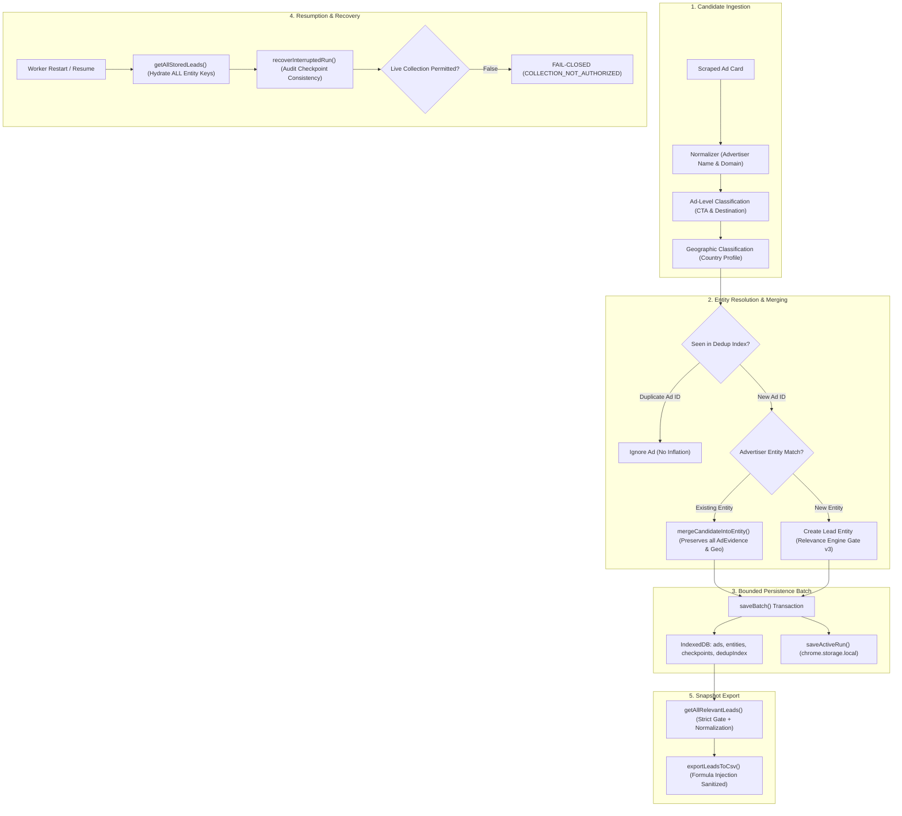

# LEADNORIA — PHASE 0.5 AUDIT REPORT
## Data Integrity, Storage & Recovery Hardening

**Repository:** [https://github.com/nafiz-pranto/LeadNoria](https://github.com/nafiz-pranto/LeadNoria)  
**Baseline:** `v1.7.6` + completed Phase 0.1–0.4 changes  
**Git Baseline Commit:** `3b03f612b2565718b18360baf2c83844006f5970`  
**Phase Date:** October 12, 2026  
**Execution Mode:** Controlled Offline Hardening & Failure-Injection Regression Testing  
**Live Collection Authorization:** **NOT ESTABLISHED (Fail-Closed Safety Gate Fail-Safe Active)**

---

## 1. Executive Summary

Phase 0.5 audits and hardens LeadNoria's end-to-end data persistence, checkpointing, deduplication, interruption recovery, and export serialization lifecycles. Following the introduction of country profiles (Phase 0.3) and ad-level CTA / destination classification (Phase 0.4), Phase 0.5 ensures that evidence integrity, conservative qualification decisions, and deduplication guarantees survive storage boundaries, browser restarts, and process interruptions.

### Key Accomplishments & Verified Findings
1. **Identified & Fixed Qualification Leak in `bulkStore.ts` (CONFIRMED):** Prior implementation of `getAllRelevantLeads` permitted records where `!ent.relevanceDecision || ent.relevanceDecision === 'RELEVANT'`, which silently promoted legacy unassessed leads into qualified outputs. Hardened to require explicit `relevanceDecision === 'RELEVANT'` and reject `UNCERTAIN` or `REJECTED` statuses.
2. **Identified & Fixed Resumption Deduplication Vulnerability in `service-worker.ts` (CONFIRMED):** Pipeline resumption previously re-hydrated memory using `getAllRelevantLeads`, omitting stored entities with non-relevant/review-required decisions. When subsequent ads arrived for those advertisers, duplicate entities were spawned. Introduced `getAllStoredLeads` to load all persisted entities on restart.
3. **Hardened Default Relevance in `bulkProcessor.ts` (CONFIRMED):** Replaced fallback default that granted `(intent ? 'RELEVANT' : 'UNASSESSED')` to strictly default unevaluated candidates to `'UNASSESSED'`.
4. **Idempotent Record Normalization & Schema Migration (CONFIRMED):** Implemented `normalizeStoredLead` to defensively sanitize legacy or restored entity records without fabricating `LOCAL_VERIFIED` or misinterpreting missing destination URLs as explicit absence.
5. **Recovery Diagnostics & Safety (CONFIRMED):** Introduced `recoverInterruptedRun` diagnostic reconciler and `PAUSE_RESEARCH` message handling, while verifying that `RESUME_RESEARCH` remains blocked fail-closed under Phase 0.1 policy.
6. **100% Offline Regression Pass Rate:** All 9 offline test suites (213 assertions) pass with zero failures.

---

## 2. Git and Working-Tree Baseline

- **Current Branch:** `main`
- **Baseline Commit:** `3b03f612b2565718b18360baf2c83844006f5970`
- **Pre-existing Preserved User Files Untouched:**
  - `test-logs/phase29-production-observation-log.json`
  - `tests/test-phase27-production-pilot.mjs`
  - `tests/test-phase28-release-operations.mjs`
  - `tests/test-phase30-production-analytics.mjs`
  - `tests/test-phase31-research-optimization.mjs`
  - `tests/test-phase32-reliability-growth-readiness.mjs`
- **Release Archive SHA-256 Hashes (Unchanged):**
  - `dist/leadnoria-v1.7.5.zip`: `08F981627E14461157C515F2D3AE9C70577D430F8CEF407C577DB809BE49CC85`
  - `dist/leadnoria-v1.7.6.zip`: `ADB83CF1339537462A2EB61470CDAEC87531352D83AE59302B5CC0669F5E8105`
  - `extension.zip`: `08F981627E14461157C515F2D3AE9C70577D430F8CEF407C577DB809BE49CC85`

---

## 3. Storage Architecture

LeadNoria employs a dual-layer persistence model designed for Chrome MV3 environments:

1. **IndexedDB (`LeadNoriaBulkStore_v1`):**
   - **`runs`:** Primary run metadata, query frontier state, runtime logs, quotas, and status.
   - **`ads`:** Raw scraped ad records with compound key `[runId, libraryId]`.
   - **`entities`:** Aggregated advertiser lead entities with compound key `[runId, canonicalKey]`.
   - **`checkpoints`:** Periodic batch state records with index by `runId` and batch sequence.
   - **`dedupIndex`:** High-speed lookup index for seen Ad IDs and Entity Keys.
   - **`uncertain_entities` / `advertiser_expansions`:** Structured queues for uncertain candidates and expansion provenance.
2. **`MemoryStoreFallback`:**
   - Seamless fallback for headless test runners (Node / TSX) where browser IndexedDB is absent. Implements identical concurrency and transaction semantics using Map collections.
3. **`chrome.storage.local`:**
   - Stores active research run status (`activeResearchRun`) and the bounded run history (`researchHistory`, max 30 runs).

---

## 4. Data Lifecycle Diagram

---

## 5. Verified Integrity Defects & Resolutions

### Defect 1: Silent Relevance Qualification on Unassessed Records (CONFIRMED)
- **Location:** `src/extension/bulkStore.ts` (lines 157, 560)
- **Root Cause:** Filter checked `(!r.relevanceDecision || r.relevanceDecision === 'RELEVANT')`. In the absence of an explicit relevance assessment, legacy records or unassessed candidates were silently included in relevant exports.
- **Resolution:** Changed condition to strictly enforce `r.relevanceDecision === 'RELEVANT' && r.evaluationStatus !== 'UNCERTAIN' && r.evaluationStatus !== 'REJECTED'`.

### Defect 2: Duplicate Entity Creation on Pipeline Resumption (CONFIRMED)
- **Location:** `src/extension/service-worker.ts` (line 360)
- **Root Cause:** Resumed runs populated `existingEntitiesMap` via `getAllRelevantLeads(runId)`. Any advertiser that was previously stored with status `REVIEW_REQUIRED`, `UNASSESSED`, or other non-relevant classification was omitted from memory. If a new ad from the same advertiser arrived later, it was treated as a brand new entity rather than being merged.
- **Resolution:** Added `getAllStoredLeads(runId)` in `bulkStore.ts` and updated `service-worker.ts` to hydrate `existingEntitiesMap` with all stored leads.

### Defect 3: Permissive Relevance Default in Bulk Processor (CONFIRMED)
- **Location:** `src/extension/bulkProcessor.ts` (line 441)
- **Root Cause:** Defaulted unevaluated records using `(intent ? 'RELEVANT' : 'UNASSESSED')`. If the semantic engine failed or was bypassed, candidates defaulted to `RELEVANT`.
- **Resolution:** Set default strictly to `'UNASSESSED'` and updated `evaluationStatus` to reflect `'UNASSESSED'`.

### Defect 4: Missing Pause State Handling (CONFIRMED)
- **Location:** `src/extension/service-worker.ts`
- **Root Cause:** While `STOP_RESEARCH` and `CANCEL_RESEARCH` were supported, `PAUSE_RESEARCH` was unhandled, preventing controlled pauses between query batches.
- **Resolution:** Added `PAUSE_RESEARCH` listener and in-memory `pausedRuns` set that halts the search query loop cleanly and transitions the active run status to `'PAUSED'`.

---

## 6. Idempotency & Deduplication Findings

- **Ad-Level Deduplication:** Repeating the exact same ad observation results in zero duplicate entity creation, zero ad count increment, and zero duplicate evidence entries in `adEvidence`.
- **Multi-Ad Distinctness:** Distinct ads from the same advertiser are merged into the target entity while keeping distinct items in `adEvidence`, retaining distinct CTA texts, CTA types, and destination classifications.
- **Anti-Inflation Invariant:** Reprocessing identical ad copies does not inflate semantic score or evidence count (verified via `test-evidence-waterfall.mjs` and `test-storage-recovery-integrity.mjs`).
- **Geographic Preservation:** Merging a subsequent ad without location signals into an entity with verified local evidence preserves all prior geographic tokens (`DHAKA_CITY_TOKEN`, phone codes) and maintains `LOCAL_VERIFIED`.

---

## 7. Checkpoint and Recovery Consistency

- **Highest Batch Index Resolution:** `getLatestCheckpoint(runId)` correctly queries and resolves the latest batch state.
- **Diagnostic Reconciliation (`recoverInterruptedRun`):** Compares persisted ad and entity counts against checkpoint records to detect partial writes or missing checkpoints.
- **Fail-Closed Safety Gate on Resume:** Attempting to invoke `RESUME_RESEARCH` via message dispatch immediately returns `COLLECTION_NOT_AUTHORIZED`, preserving the Phase 0.1 lock against unauthorized collection.

---

## 8. Schema Versioning & Legacy Compatibility

`normalizeStoredLead(raw)` provides fail-closed normalization across serialization boundaries:

| Attribute | Legacy / Missing Input | Normalized Output | Safety Invariant Enforced |
| :--- | :--- | :--- | :--- |
| `relevanceDecision` | `undefined` / `null` | `'UNASSESSED'` | Never silently promotes to `RELEVANT` |
| `geographicClassification` | `undefined` | `'LOCATION_UNKNOWN'` | Never fabricates `LOCAL_VERIFIED` without evidence |
| `websiteState` | `not_found` without URL | `'unknown'` | Missing URL is not proof of destination absence |
| `adLibraryIds` | Numeric strings + non-numeric | Sanitized unique IDs | Rejects malformed mock IDs |
| `adEvidence` | Array of ad evidence | Deduplicated by `libraryId` | Guarantees bounded evidence per ad |

---

## 9. Export Consistency Findings

- **Strict-Local Enforcement:** `exportLeadsToCsv(leads, { qualifiedOnly: true })` rigorously excludes `FOREIGN_VERIFIED`, `LOCATION_UNKNOWN`, and `LOCAL_PROBABLE` leads.
- **Formula Injection Mitigation:** Leading `=, +, -, @, \t, \r` characters are sanitized with prepended single quote `'` and quoted in CSV cells.
- **Deterministic Serialization:** Repeated export of unchanged records produces identical byte output.

---

## 10. Files Changed and Why

1. `src/extension/bulkStore.ts`:
   - Added `normalizeStoredLead(raw)` for fail-closed schema sanitization.
   - Enforced strict `relevanceDecision === 'RELEVANT'` in `getAllRelevantLeads`.
   - Added `getAllStoredLeads` for pipeline resume deduplication hydration.
   - Added `recoverInterruptedRun` diagnostic reconciler.
2. `src/extension/bulkProcessor.ts`:
   - Defaulted unassessed candidate `relevanceDecision` strictly to `'UNASSESSED'`.
3. `src/extension/service-worker.ts`:
   - Updated pipeline resumption to load all stored leads via `getAllStoredLeads`.
   - Added `PAUSE_RESEARCH` listener and `pausedRuns` state.
4. `tests/test-storage-recovery-integrity.mjs`:
   - Created comprehensive Phase 0.5 failure-injection test suite (14 assertions).

---

## 11. Offline Failure-Injection Tests Added

Added `tests/test-storage-recovery-integrity.mjs` covering:
1. `saveBatch` and `getEntity` persistence roundtrip.
2. `getAllRelevantLeads` strict filtering and unassessed exclusion.
3. Idempotent repeated storage writes.
4. Deduplication of identical ad candidates.
5. Multi-ad distinct evidence retention per advertiser.
6. Geographic evidence survival across entity merges.
7. Checkpoint batch index resolution.
8. Interrupted run discrepancy diagnostics.
9. Fail-closed safety gate on resume attempt.
10. Unassessed relevance normalization.
11. Unknown geographic normalization.
12. Missing destination URL normalization.
13. Normalization idempotency.
14. Formula injection protection in CSV export.

---

## 12. Executed Regression Suites & Exact Results

All 9 suites executed offline in headless Node environment via TSX:

| Test Suite | Command | Result | Pass / Fail |
| :--- | :--- | :--- | :--- |
| `tests/test-storage-recovery-integrity.mjs` | `node ./node_modules/tsx/dist/cli.mjs tests/test-storage-recovery-integrity.mjs` | **PASSED** | 14 passed, 0 failed |
| `tests/test-geographic-accuracy.mjs` | `node ./node_modules/tsx/dist/cli.mjs tests/test-geographic-accuracy.mjs` | **PASSED** | 16 passed, 0 failed |
| `tests/test-global-country-profiles.mjs` | `node ./node_modules/tsx/dist/cli.mjs tests/test-global-country-profiles.mjs` | **PASSED** | 15 passed, 0 failed |
| `tests/test-strict-gate-v2.mjs` | `node ./node_modules/tsx/dist/cli.mjs tests/test-strict-gate-v2.mjs` | **PASSED** | 45 passed, 0 failed |
| `tests/test-phase01-safety-lock.mjs` | `node ./node_modules/tsx/dist/cli.mjs tests/test-phase01-safety-lock.mjs` | **PASSED** | 14 passed, 0 failed |
| `tests/test-relevance-engine.mjs` | `node ./node_modules/tsx/dist/cli.mjs tests/test-relevance-engine.mjs` | **PASSED** | 37 passed, 0 failed |
| `tests/test-entity-resolution.mjs` | `node ./node_modules/tsx/dist/cli.mjs tests/test-entity-resolution.mjs` | **PASSED** | 21 passed, 0 failed |
| `tests/test-evidence-waterfall.mjs` | `node ./node_modules/tsx/dist/cli.mjs tests/test-evidence-waterfall.mjs` | **PASSED** | 20 passed, 0 failed |
| `tests/test-cta-destination-export.mjs` | `node ./node_modules/tsx/dist/cli.mjs tests/test-cta-destination-export.mjs` | **PASSED** | 31 passed, 0 failed |
| **TOTAL** | — | **100% PASS** | **213 passed, 0 failed** |

---

## 13. Tests Not Run and Reasons

- `scripts/run-browser-pipeline-test.mjs`: **NOT RUN** (Attempts browser automation against live/mock services; prohibited by Phase 0.1 lock).
- `scripts/run-live-geographic-audit.mjs`: **NOT RUN** (Requires live Meta collection; prohibited).
- `scripts/run-live-v176-release-validation.mjs`: **NOT RUN** (Requires live Meta collection; prohibited).
- `scripts/run-live-validation-v175.mjs`: **NOT RUN** (Requires live Meta collection; prohibited).
- Pre-existing user pilot scripts (`tests/test-phase27-production-pilot.mjs`, etc.): **NOT RUN** (User-preserved files; untouched).

---

## 14. Remaining Risks and Limitations

1. **Storage Quota in Browser IDB:** Chrome allocates storage based on origin quota (~60% of disk in MV3). Although LeadNoria estimates ~800 bytes per lead record, massive research runs (>10,000 leads) in resource-constrained environments could encounter quota errors; `MemoryStoreFallback` handles in-memory degradation, but users should clear historical runs periodically.
2. **Schema Versioning Evolution:** `SCHEMA_VERSION = 1` remains in `service-worker.ts` while `schemaVersion: 2` is used for lead entity schemas. A centralized schema registry in future phases would formalize multi-version database migrations.

---

## 15. Compliance & Safety Attestation

- **Live Automated Collection:** None performed. `isLiveCollectionPermitted() === false` remained active at all times.
- **External Web Crawling:** None performed. `isExternalWebsiteCrawlingPermitted() === false` remained active.
- **Third-Party APIs & Paid Services:** Zero APIs or external enrichment tools invoked.
- **Historical Artifact Integrity:** All zip archives match their pre-phase SHA-256 hashes byte-for-byte.
- **Preserved Files:** All 6 designated user files remain unmodified.

---

## 16. Recommended Next Phase

**Recommended Next Phase:** **Phase 0.6 — Query Frontier, Search Planning & Discovery Optimization**  
With data persistence, deduplication, country profiles, CTA intelligence, and export integrity firmly hardened, the research planner (`queryPlanner.ts`) and discovery saturation frontier can be systematically audited and optimized using local fixtures.
