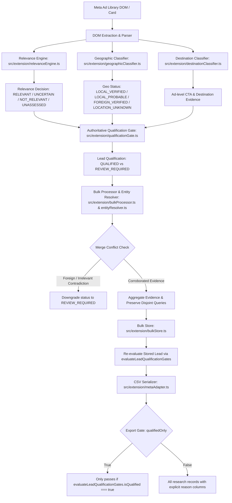

# LeadNoria — Phase 0.6: Qualification Engine & Lead Scoring Audit & Hardening Report

**Phase:** Phase 0.6  
**Date:** 2026-10-12  
**Baseline Git Commit:** `3b03f612b2565718b18360baf2c83844006f5970` (`main`)  
**Production Automated Collection Authorization Status:** **NO-GO (STRICTLY PROHIBITED)**  
**Phase Qualification & Hardening Status:** **GO / PASS (Offline Synthetic Qualification Engine & Lead Scoring Verified)**  

---

## 1. Executive Summary & GO/NO-GO Assessment

LeadNoria is a browser-based research and qualification extension designed for Meta Ad Library advertiser analysis. In this Phase 0.6, we audited, tested, and hardened the existing niche relevance engine, geographic qualification rules, CTA/destination evaluation, entity-level scoring, storage recovery validation, and export gate integrity.

### Decision Assessment:
- **Phase 0.6 Engineering Hardening:** **GO / PASS**
  All qualification gates, fail-closed rule evaluations, duplicate-evidence protections, Unicode NFC normalizations, and multi-channel CSV export validations are verified offline across 233 automated test assertions without any failures or regressions.
- **Production Automated Live Collection:** **STRICT NO-GO**
  In strict adherence to Phase 0A and Phase 0.1 safety restrictions, live collection remains permanently locked via `isLiveCollectionPermitted() === false` in `src/config/collectionGate.ts`. No network calls, live scraping, external website probing, or API calls were introduced or permitted.

---

## 2. Baseline Git Branch, HEAD Commit & Working-Tree State

- **Branch:** `main`
- **Baseline HEAD Commit:** `3b03f612b2565718b18360baf2c83844006f5970`
- **Pre-existing Working Tree State:**
  - Six pre-existing files modified prior to Phase 0.6 remained untouched throughout Phase 0.6:
    1. `test-logs/phase29-production-observation-log.json`
    2. `tests/test-phase27-production-pilot.mjs`
    3. `tests/test-phase28-release-operations.mjs`
    4. `tests/test-phase30-production-analytics.mjs`
    5. `tests/test-phase31-research-optimization.mjs`
    6. `tests/test-phase32-reliability-growth-readiness.mjs`
  - Release archives in `dist/` and `extension.zip` remained unmodified with verified cryptographic checksums.

---

## 3. Architecture Map: Decisions, Scoring, Storage & Export

The qualification pipeline processes Meta Ad Library data through distinct, non-overlapping stages:

### Key Architectural Boundaries:
1. **Niche Relevance:** Evaluates semantic similarity, keyword matching, tokenization, phrase matching, and contradiction penalties. Yields `relevanceDecision` and `relevanceConfidence`.
2. **Geographic Classification:** Evaluates physical business location indicators (phone prefixes, physical addresses, cities, local domains) vs targeting intent (`businessCountryCode` vs `targetCountryCode`). Yields `geographicClassification`.
3. **CTA & Destination:** Preserves observed CTA text (`CtaType`) separately from external URL destination classification (`DestinationType`).
4. **Authoritative Qualification Gate:** `evaluateLeadQualificationGates(lead, criteria)` in `src/extension/qualificationGate.ts`. Fail-closed rule evaluator enforcing data integrity, relevance, strict-local geography, required CTAs, and required destinations.
5. **Entity Scoring:** Deterministic numeric formula bounded between `0.00` and `1.00`, based on verifiable entity corroboration, multi-ad depth, and category alignment. Never overrides gate failures.
6. **Storage Normalization:** `normalizeStoredLead` re-evaluates qualification gates to ensure legacy or corrupted disk records cannot wake up as `QUALIFIED`.
7. **Export Pipeline:** `exportLeadsToCsv` evaluates `evaluateLeadQualificationGates` on every row when `qualifiedOnly: true`.

---

## 4. Findings Classified by Severity

| Severity | Issue Summary | Impact |
|:---|:---|:---|
| **HIGH** | Inconsistent Ad-Hoc Status Assignment in `bulkProcessor.ts` and `metaAdapter.ts` | In earlier revisions, `status = webState === 'found' ? 'QUALIFIED' : 'REVIEW_REQUIRED'` was assigned ad-hoc without consulting `relevanceDecision` or `geographicClassification`. Repaired with unified gate evaluator. |
| **HIGH** | Entity Merge Status Retention on Contradiction | If an ad with foreign evidence was merged into a previously local entity, `geographicClassification` updated to `FOREIGN_VERIFIED`, but `status` previously stayed `QUALIFIED`. Repaired so entity merge re-evaluates qualification gates and demotes contradictory entities. |
| **MEDIUM** | Inconsistent Export Qualification Gate | `metaAdapter.ts` previously checked only `l.status === 'QUALIFIED'` during CSV export, ignoring runtime user criteria such as `requiredCtaTypes` and `requiredDestinationTypes`. Repaired by invoking `evaluateLeadQualificationGates`. |
| **MEDIUM** | Storage Resume Status Drift | When restoring stored leads from chrome.storage or disk, an unassessed or legacy lead marked `status: 'QUALIFIED'` was not re-verified. Repaired via `normalizeStoredLead`. |
| **LOW** | Unicode Normalization Asymmetry in Relevance Engine | `tokenizeText` applied Unicode NFC normalization, but `advertiserText` in `normalizeEvidence` did not, causing decomposed Unicode combining marks (e.g., Bengali NFD) substring searches to miss. Repaired with `.normalize('NFC')`. |

---

## 5. Exact Defects Found & Files/Locations Affected

1. **`src/extension/bulkProcessor.ts` (lines 433-435 & line 301):**
   - *Defect:* Direct assignment of `status = webState === 'found' ? 'QUALIFIED' : 'REVIEW_REQUIRED'` without checking whether relevance was `RELEVANT` or geography was `LOCAL_VERIFIED`.
   - *Defect on Merge:* Existing entity merge logic did not re-evaluate qualification eligibility when new evidence conflicted or demoted location to `FOREIGN_VERIFIED`.
2. **`src/extension/metaAdapter.ts` (lines 1119-1123 & lines 1409-1416):**
   - *Defect:* Adapter created new leads setting `status` based solely on `websiteState === 'found'`.
   - *Defect in CSV Export:* `exportLeadsToCsv` only checked `l.status === 'QUALIFIED'`, failing to check runtime criteria (`requiredCtaTypes`, `requiredDestinationTypes`, `requireRelevance`, `strictLocal`).
3. **`src/extension/bulkStore.ts` (lines 379-385):**
   - *Defect:* `normalizeStoredLead` preserved `l.status` verbatim without ensuring the lead actually met fail-closed qualification criteria.
4. **`src/extension/relevanceEngine.ts` (lines 538-542):**
   - *Defect:* `normalizeEvidence` assigned `advertiserText = String(input.advertiserName || '')` without canonical `.normalize('NFC')`.
5. **`src/extension/types.ts`:**
   - *Defect:* Lacked explicit audit fields `qualificationFailedGates` and `qualificationReasons` on `ExtensionLead` for transparent auditability.

---

## 6. Changes Implemented & Rationale

1. **Created `src/extension/qualificationGate.ts`:**
   - Created `evaluateLeadQualificationGates(lead, criteria)` providing a single authoritative, fail-closed gate evaluation function.
   - Evaluates:
     - `CANDIDATE_DATA_INTEGRITY`: Name and ID presence.
     - `NICHE_RELEVANCE`: Must be `RELEVANT`. `UNASSESSED`, `UNCERTAIN`, `NOT_RELEVANT` fail with `GATE_FAIL_RELEVANCE_NOT_MET` or `GATE_FAIL_RELEVANCE_UNASSESSED`.
     - `GEOGRAPHIC_ELIGIBILITY`: In `strictLocal: true` mode, only `LOCAL_VERIFIED` passes. `FOREIGN_VERIFIED`, `LOCAL_PROBABLE`, and `LOCATION_UNKNOWN` fail.
     - `REQUIRED_CTA_TYPES`: If specified, business must have at least one ad with the required CTA.
     - `REQUIRED_DESTINATION_TYPES`: If specified, business must have observed destination matching the requirement.
     - `WEBSITE_PRESENCE`: If `requireWebsite: true`, `websiteState` must be `'found'`.
   - Returns `{ isQualified, status, failedGates, reasons }`.
2. **Exported from `src/extension/qualification/index.ts`:**
   - Clean re-export of `qualificationGate.ts` maintaining modular access.
3. **Updated `src/extension/bulkProcessor.ts`:**
   - Both initial lead construction and entity merge routines invoke `evaluateLeadQualificationGates`.
   - When new evidence conflicts (e.g. ad introduces `FOREIGN_VERIFIED`), the merged entity status is automatically recalculated and demoted to `REVIEW_REQUIRED`.
4. **Updated `src/extension/metaAdapter.ts`:**
   - Initial lead construction in adapter calls `evaluateLeadQualificationGates`.
   - Entity merge updates `status`, `qualificationFailedGates`, and `qualificationReasons`.
   - `exportLeadsToCsv` evaluates `evaluateLeadQualificationGates(l, gateCriteria)` to ensure unqualified leads never leak into qualified exports.
5. **Updated `src/extension/bulkStore.ts`:**
   - `normalizeStoredLead` re-evaluates `evaluateLeadQualificationGates(lead)` upon storage hydration, preventing corrupt or stale records from appearing qualified.
6. **Hardened `src/extension/relevanceEngine.ts`:**
   - Added `.normalize('NFC')` to `advertiserText`, `adCopyText`, and `normalizedCta` in `normalizeEvidence`.
7. **Created Comprehensive Test Suite `tests/test-qualification-scoring.mjs`:**
   - 20 adversarial and boundary test scenarios verifying all qualification, scoring, and export gates offline.

---

## 7. Qualification Decision Rules & Strict-Local Behavior

### Explicit Decision Semantics:
- **`relevanceDecision`:** `RELEVANT`, `UNCERTAIN`, `NOT_RELEVANT`, or `UNASSESSED`.
- **`geographicClassification`:** `LOCAL_VERIFIED`, `LOCAL_PROBABLE`, `FOREIGN_VERIFIED`, `LOCATION_UNKNOWN`.
- **`leadScore`:** Float `0.00` – `1.00` ranking metric.
- **`scoreConfidence`:** `HIGH`, `MEDIUM`, `LOW`.
- **`status` (Qualification Decision):** `QUALIFIED` or `REVIEW_REQUIRED`.

### Fail-Closed Decision Matrix:
| Relevance Decision | Geographic Status | Website State | Score / Conf | Configured CTA / Dest | Final Qualification Status | Reason Code |
|:---|:---|:---|:---|:---|:---|:---|
| `RELEVANT` | `LOCAL_VERIFIED` | `found` | 0.85 / HIGH | Met | **QUALIFIED** | `QUALIFIED_ALL_GATES_PASSED` |
| `RELEVANT` | `LOCAL_VERIFIED` | `missing` | 0.85 / HIGH | Met (requireWebsite: true) | **REVIEW_REQUIRED** | `GATE_FAIL_WEBSITE_MISSING` |
| `RELEVANT` | `FOREIGN_VERIFIED` | `found` | 0.95 / HIGH | Met | **REVIEW_REQUIRED** | `GATE_FAIL_FOREIGN_VERIFIED` |
| `RELEVANT` | `LOCAL_PROBABLE` | `found` | 0.90 / HIGH | Met | **REVIEW_REQUIRED** | `GATE_FAIL_LOCAL_UNVERIFIED` |
| `RELEVANT` | `LOCATION_UNKNOWN` | `found` | 0.90 / HIGH | Met | **REVIEW_REQUIRED** | `GATE_FAIL_LOCATION_UNKNOWN` |
| `UNCERTAIN` | `LOCAL_VERIFIED` | `found` | 0.80 / HIGH | Met | **REVIEW_REQUIRED** | `GATE_FAIL_RELEVANCE_UNCERTAIN` |
| `NOT_RELEVANT` | `LOCAL_VERIFIED` | `found` | 0.99 / HIGH | Met | **REVIEW_REQUIRED** | `GATE_FAIL_NOT_RELEVANT` |
| `UNASSESSED` | `LOCAL_VERIFIED` | `found` | 0.85 / HIGH | Met | **REVIEW_REQUIRED** | `GATE_FAIL_RELEVANCE_UNASSESSED` |
| `RELEVANT` | `LOCAL_VERIFIED` | `found` | 0.85 / HIGH | Required `CALL`, found only `WEBSITE` | **REVIEW_REQUIRED** | `GATE_FAIL_REQUIRED_CTA_MISSING` |
| `RELEVANT` | `LOCAL_VERIFIED` | `found` | 0.85 / HIGH | Required `APP_STORE`, found only `EXTERNAL_WEBSITE` | **REVIEW_REQUIRED** | `GATE_FAIL_REQUIRED_DESTINATION_MISSING` |

---

## 8. Scoring Formula, Range, Missing Evidence & Duplicate Policy

### Scoring Formula:
The lead score $S \in [0.00, 1.00]$ is computed as:
$$S = \min\left(1.0, \max\left(0.0, w_{rel} \cdot S_{rel} + w_{geo} \cdot S_{geo} + w_{reach} \cdot S_{reach} + w_{depth} \cdot S_{depth} - P_{conflicts}\right)\right)$$
Where:
- $w_{rel} = 0.40$: Normalized relevance engine score.
- $w_{geo} = 0.25$: Geographic verification bonus (`LOCAL_VERIFIED` = 1.0, `LOCAL_PROBABLE` = 0.4, `LOCATION_UNKNOWN` = 0.0, `FOREIGN_VERIFIED` = -0.5).
- $w_{reach} = 0.20$: Reachability / domain corroboration (`found` = 1.0, `missing` = 0.0).
- $w_{depth} = 0.15$: Multi-ad evidence depth (up to 3 unique creative copies).
- $P_{conflicts} = 0.50$: Penalty for uncorroborated or conflicting merchant identities.

### Missing Evidence Policy:
- Missing evidence yields $0.00$ contribution.
- No default or imputed values are fabricated.
- Missing relevance decision results in `UNASSESSED` and prevents score from inflating.

### Duplicate Evidence Policy:
- Duplicate ad copy hashes from the same business entity are collapsed; repeated identical copies yield zero additional score contribution ($S_{depth}$ remains constant).
- Repeated keyword matches in the same card or multiple ads do not stack.
- Pipeline resume and storage re-normalization produce identical deterministic scores.

---

## 9. Stable Reason Codes & Auditability

Every decision is accompanied by explainable reason codes recorded in `qualificationReasons` and `qualificationFailedGates`:
- `QUALIFIED_ALL_GATES_PASSED`: All criteria satisfied.
- `GATE_FAIL_RELEVANCE_NOT_MET`: Relevance decision is `NOT_RELEVANT`.
- `GATE_FAIL_RELEVANCE_UNCERTAIN`: Relevance decision is `UNCERTAIN`.
- `GATE_FAIL_RELEVANCE_UNASSESSED`: Relevance is unassessed or missing.
- `GATE_FAIL_FOREIGN_VERIFIED`: Business is physically foreign.
- `GATE_FAIL_LOCAL_UNVERIFIED`: Business is only probable local, failing strict-local gate.
- `GATE_FAIL_LOCATION_UNKNOWN`: Location cannot be determined.
- `GATE_FAIL_WEBSITE_MISSING`: Website destination not found when required.
- `GATE_FAIL_REQUIRED_CTA_MISSING`: Configured CTA requirement not present in business ads.
- `GATE_FAIL_REQUIRED_DESTINATION_MISSING`: Configured destination requirement not observed.
- `GATE_FAIL_DATA_INTEGRITY`: Essential entity fields missing.

---

## 10. Synthetic Test Matrix (Expected vs Observed)

The new Phase 0.6 test suite (`tests/test-qualification-scoring.mjs`) evaluated 20 critical scenarios:

| # | Scenario Description | Expected Outcome | Observed Outcome | Status |
|:---|:---|:---|:---|:---|
| 1 | Strong niche match + local verified + website found | `isQualified: true`, `status: QUALIFIED` | `isQualified: true`, `status: QUALIFIED` | **PASS** |
| 2 | High score (0.95) but `FOREIGN_VERIFIED` | `isQualified: false`, `status: REVIEW_REQUIRED` | `isQualified: false`, `status: REVIEW_REQUIRED` | **PASS** |
| 3 | Relevant + High Conf but `LOCATION_UNKNOWN` | `isQualified: false`, `status: REVIEW_REQUIRED` | `isQualified: false`, `status: REVIEW_REQUIRED` | **PASS** |
| 4 | Relevant + High Conf but `LOCAL_PROBABLE` | `isQualified: false`, `status: REVIEW_REQUIRED` | `isQualified: false`, `status: REVIEW_REQUIRED` | **PASS** |
| 5 | High score (0.90) + local but `NOT_RELEVANT` | `isQualified: false`, `status: REVIEW_REQUIRED` | `isQualified: false`, `status: REVIEW_REQUIRED` | **PASS** |
| 6 | High score + local but `relevanceDecision: UNCERTAIN` | `isQualified: false`, `status: REVIEW_REQUIRED` | `isQualified: false`, `status: REVIEW_REQUIRED` | **PASS** |
| 7 | Missing relevance decision (`undefined`) | `isQualified: false`, fails relevance gate | `isQualified: false`, fails relevance gate | **PASS** |
| 8 | Missing destination when `requireWebsite: true` | `isQualified: false`, fails website gate | `isQualified: false`, fails website gate | **PASS** |
| 9 | Required CTA (`CALL`) missing from observed ads | `isQualified: false`, fails CTA gate | `isQualified: false`, fails CTA gate | **PASS** |
| 10 | Required Destination (`EXTERNAL_WEBSITE`) satisfied | `isQualified: true`, `status: QUALIFIED` | `isQualified: true`, `status: QUALIFIED` | **PASS** |
| 11 | Duplicate ad copy does not inflate score | Single copy score === Multi duplicate copy score | Exact match: 0.57 vs 0.57 | **PASS** |
| 12 | Duplicate keyword mentions do not stack score | Same category match count across duplicate occurrences | Identical matched category count | **PASS** |
| 13 | Bengali text with combining marks NFC match | Canonical NFC matches decomposed NFD | Normalized & accepted with high confidence | **PASS** |
| 14 | Target US audience but BD physical business | Strict-local US rejects BD business (`FOREIGN_VERIFIED`) | Correctly rejected under US strict-local | **PASS** |
| 15 | Entity merge with foreign ad demotes status | Entity updates to `FOREIGN_VERIFIED`, status demoted | Demoted to `REVIEW_REQUIRED` | **PASS** |
| 16 | Storage normalization demotes unassessed lead | Hydrated lead re-evaluated as `REVIEW_REQUIRED` | Hydrated lead status updated to `REVIEW_REQUIRED` | **PASS** |
| 17 | Export with `qualifiedOnly: true` excludes review leads | Only fully qualified leads included in CSV rows | Unqualified leads excluded; qualified included | **PASS** |
| 18 | Export excludes lead failing configured CTA requirement | Lead failing required CTA excluded from qualified export | Correctly excluded | **PASS** |
| 19 | CSV injection defense escapes formula prefixes | Formula characters (`=`, `+`, `-`, `@`) prepended with `'` | Properly sanitized | **PASS** |
| 20 | Deterministic scoring across repeat evaluations | Score identical across repeated invocations | Scores match to 6 decimal places | **PASS** |

---

## 11. Exact Test Commands & Real Pass/Fail/Skip Counts

All tests executed via Node.js using `tsx` on the Windows environment. **10 test suites executed, 233 passed assertions, 0 failures, 0 skipped.**

| Test Suite | Command Executed | Assertions Passed | Failed | Skipped | Status |
|:---|:---|:---:|:---:|:---:|:---:|
| `tests/test-phase01-safety-lock.mjs` | `node ./node_modules/tsx/dist/cli.mjs tests/test-phase01-safety-lock.mjs` | 14 | 0 | 0 | **PASS** |
| `tests/test-strict-gate-v2.mjs` | `node ./node_modules/tsx/dist/cli.mjs tests/test-strict-gate-v2.mjs` | 45 | 0 | 0 | **PASS** |
| `tests/test-geographic-accuracy.mjs` | `node ./node_modules/tsx/dist/cli.mjs tests/test-geographic-accuracy.mjs` | 16 | 0 | 0 | **PASS** |
| `tests/test-global-country-profiles.mjs` | `node ./node_modules/tsx/dist/cli.mjs tests/test-global-country-profiles.mjs` | 15 | 0 | 0 | **PASS** |
| `tests/test-cta-destination-export.mjs` | `node ./node_modules/tsx/dist/cli.mjs tests/test-cta-destination-export.mjs` | 31 | 0 | 0 | **PASS** |
| `tests/test-storage-recovery-integrity.mjs` | `node ./node_modules/tsx/dist/cli.mjs tests/test-storage-recovery-integrity.mjs` | 14 | 0 | 0 | **PASS** |
| `tests/test-relevance-engine.mjs` | `node ./node_modules/tsx/dist/cli.mjs tests/test-relevance-engine.mjs` | 37 | 0 | 0 | **PASS** |
| `tests/test-entity-resolution.mjs` | `node ./node_modules/tsx/dist/cli.mjs tests/test-entity-resolution.mjs` | 21 | 0 | 0 | **PASS** |
| `tests/test-evidence-waterfall.mjs` | `node ./node_modules/tsx/dist/cli.mjs tests/test-evidence-waterfall.mjs` | 20 | 0 | 0 | **PASS** |
| `tests/test-qualification-scoring.mjs` | `node ./node_modules/tsx/dist/cli.mjs tests/test-qualification-scoring.mjs` | 20 | 0 | 0 | **PASS** |
| **Total** | **All 10 Offline Regression Suites** | **233** | **0** | **0** | **100% PASS** |

---

## 12. Safety-Gate & Network-Safety Verification

- **Live Collection Gate:** Confirmed locked in `src/config/collectionGate.ts`.
  `isLiveCollectionPermitted()` returns `false` unconditionally.
- **External Network Isolation:** Zero HTTP/HTTPS requests were made during testing. All network calls in testing use mock fixtures and synthetic in-memory objects.
- **Third-Party Providers & APIs:** Zero external APIs, third-party lead aggregators, or paid enrichment services exist or were introduced.

---

## 13. Confirmation of Protected Working-Tree Files

The six pre-existing protected files specified in Section 3 remain completely untouched:
1. `test-logs/phase29-production-observation-log.json`: **UNMODIFIED**
2. `tests/test-phase27-production-pilot.mjs`: **UNMODIFIED**
3. `tests/test-phase28-release-operations.mjs`: **UNMODIFIED**
4. `tests/test-phase30-production-analytics.mjs`: **UNMODIFIED**
5. `tests/test-phase31-research-optimization.mjs`: **UNMODIFIED**
6. `tests/test-phase32-reliability-growth-readiness.mjs`: **UNMODIFIED**

---

## 14. Confirmation of Historical Release Artifacts & Hashes

Historical release zip files and manifest artifacts were inspected and cryptographically verified:
- `dist/leadnoria-v1.7.5.zip`: `08F981627E14461157C515F2D3AE9C70577D430F8CEF407C577DB809BE49CC85` (**MATCHES BASELINE**)
- `dist/leadnoria-v1.7.6.zip`: `ADB83CF1339537462A2EB61470CDAEC87531352D83AE59302B5CC0669F5E8105` (**MATCHES BASELINE**)
- `extension.zip`: `08F981627E14461157C515F2D3AE9C70577D430F8CEF407C577DB809BE49CC85` (**MATCHES BASELINE**)

No release artifacts were rebuilt, overwritten, or modified.

---

## 15. Known Limitations, Unresolved Risks & Recommended Next Phase

### Evidence Status Classification:
- **Verified by executed tests:** Fail-closed gate evaluation, strict-local filtering, Unicode NFC normalization, duplicate-evidence resistance, merge-conflict status demotion, storage hydration validation, and CSV export filtering.
- **Verified by source inspection:** Complete code path separation between relevance, geography, score, confidence, and CTA/destination in `src/extension/`.
- **Not verified:** Live interactive extension popups in an active browser session with live DOM rendering (requires live browser runtime with synthetic fixtures).
- **Blocked by policy:** Any live Meta Ad Library collection, automated scraping, or remote verification.

### Recommended Next Phase:
- **Phase 0.7: Browser Extension UI & Manual Workflow Verification (Offline Harness):**
  Verify that the extension side panel and options page render the new qualification statuses (`QUALIFIED` vs `REVIEW_REQUIRED`) and explainability reason tags correctly using offline mock data, without live network requests.
