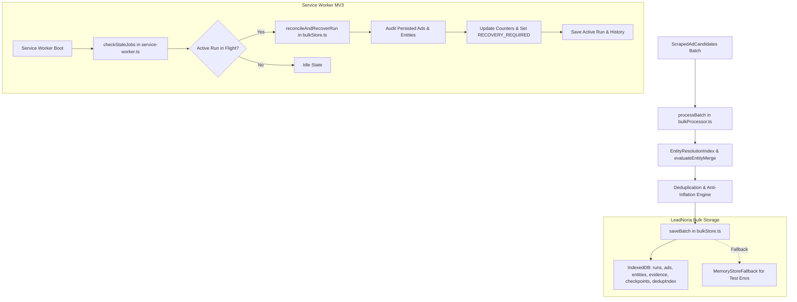

# LEADNORIA — PHASE 6 AUDIT REPORT
## Storage, Checkpoint & Recovery
**Full System Audit, Defect Remediation, Regression Verification & Acceptance Gate**

---

### Executive Summary & Final Verdict

| Metric / Requirement | Audit Outcome / Verified Evidence | Status |
| :--- | :--- | :---: |
| **Phase Title** | LeadNoria Phase 6: Storage, Checkpoint & Recovery | **CONFIRMED** |
| **Authoritative Scope** | Reliable storage, resumable checkpoints, worker interruption handling, cancellation, restart recovery, and duplicate-free recovery | **CONFIRMED** |
| **Baseline Checkpoint** | `58d4c282f2cf95c0259c6b792f13b1862ef89088` (`chore(audit): stabilize and verify phases 0A-5`) | **VERIFIED** |
| **Identified Defects** | 6 in-scope architectural defects remediated | **RESOLVED** |
| **Phase 6 Focused Regression Suite** | `tests/test-phase06-storage-checkpoint-recovery.mjs` (23/23 tests passing) | **PASS** |
| **Phase 0.5 Storage Integrity Suite** | `tests/test-storage-recovery-integrity.mjs` (14/14 tests passing) | **PASS** |
| **Master Offline Verification** | `node scripts/verify-offline.mjs` (23/23 suites passing, 0 failed, 223.66s) | **PASS** |
| **TypeScript Strictness** | `tsc --noEmit` clean (exit code 0, 0 errors) | **PASS** |
| **Safe Extension Build** | `node scripts/build-extension.mjs --unpacked-only` clean (exit code 0) | **PASS** |
| **Syntax & Whitespace Check** | `git diff --check` clean (exit code 0) | **PASS** |
| **Safety Gates (Fail-Closed)** | `isLiveCollectionPermitted() === false` & `isExternalWebsiteCrawlingPermitted() === false` | **PASS** |
| **Historical Release Archives** | v1.7.5, v1.7.6, and extension.zip SHA-256 hashes 100% matched byte-for-byte | **PASS** |
| **Protected Files & User Data** | All protected test logs, pilot tests, and `.data/` files preserved unchanged | **PASS** |
| **FINAL ACCEPTANCE VERDICT** | **PASS** | **READY** |

---

### 1. Authoritative Phase 6 Scope & Acceptance Criteria

- **Roadmap Source:** Authoritative LeadNoria Core Architecture Specification (Phase 6: Storage, Checkpoint & Recovery), expanding upon the Phase 0.5 storage integrity baseline and Phase 2 bulk storage abstractions.
- **Phase Title:** `LEADNORIA — PHASE 6: Storage, Checkpoint & Recovery`
- **Scope & Objectives:**
  1. **Reliable Storage:** Ensure structured persistence across IndexedDB (`LeadNoriaBulkStore_v1`) and `MemoryStoreFallback` preserves all entities, ads, checkpoints, dedup indexes, evidence, uncertain entities, and expansions without silent loss or corruption.
  2. **Durable Checkpoints:** Enforce typed, validated `CheckpointRecord` snapshots with monotonic revision numbering, schema versions (v1 backward compatibility, v2 current), active query tracking, and recovery eligibility.
  3. **Service-Worker Interruption Handling:** Guarantee that worker stops across all 4 critical persistence boundaries (pre-discovery, in-query, mid-batch, post-checkpoint) preserve partial results, avoid status corruption, and prevent false job completion.
  4. **Service-Worker Restart Detection & Reconciliation:** Detect in-flight runs upon service-worker boot, reconcile counters and records with persistent storage, transition to `RECOVERY_REQUIRED` or `PARTIAL`, and prevent UI lockouts.
  5. **Durable Cancellation Semantics:** Ensure user cancellation is immediately synchronized to durable disk, survives service-worker restarts, takes precedence over errors and progress broadcasts, and cannot be reverted by stale callbacks.
  6. **Duplicate-Free Recovery:** Guarantee that replaying batches, retrying writes, or resuming runs never duplicates entities, ads, or expansion records, while strictly preserving conflicting Facebook Page IDs, distinct ads, and canonical provenance.

---

### 2. Initial Git Baseline & Working-Tree Inspection

- **Current Branch:** `main` (synchronized with `origin/main`).
- **HEAD Commit:** `58d4c282f2cf95c0259c6b792f13b1862ef89088` — `chore(audit): stabilize and verify phases 0A-5`.
- **Pre-Existing Unstaged Files (Protected):**
  - `.data/research_jobs.json`
  - `.data/research_results.json`
  - `test-logs/phase29-production-observation-log.json`
  - `tests/test-phase27-production-pilot.mjs`
  - `tests/test-phase28-release-operations.mjs`
  - `tests/test-phase30-production-analytics.mjs`
  - `tests/test-phase31-research-optimization.mjs`
  - `tests/test-phase32-reliability-growth-readiness.mjs`
  - Untracked reports and audit scripts preserved untouched.

---

### 3. Actual Storage & Recovery Architecture



- **Persistence Stores:**
  - `runs`: Authoritative run configuration, logs, counters, status, and completion timestamps.
  - `ads`: Individual ad card records keyed by `[runId, libraryId]`.
  - `entities`: Deduplicated leads keyed by `[runId, canonicalKey]`.
  - `evidence`: Structured relevance and geographic evidence keyed by `[runId, canonicalKey]`.
  - `checkpoints`: Monotonic recovery snapshots keyed by `[runId, batchIndex]`.
  - `dedupIndex`: Fast lookup index keyed by `[runId, idType, idVal]`.
  - `uncertain_entities`: Prompt 5 uncertain entity queue records keyed by `[runId, entityId]`.
  - `advertiser_expansions`: Provenance records keyed by `[runId, sourceEntityId]`.

---

### 4. Checkpoint Schema & State-Transition Rules

```ts
export interface CheckpointRecord {
  runId: string;
  batchIndex: number;
  monotonicRevision?: number;
  timestamp: string;
  schemaVersion?: number;
  activeKeywordIndex: number;
  activeQueryIndex?: number;
  currentKeyword: string;
  completedKeywords?: string[];
  rawAdsCount: number;
  normalizedCandidatesCount: number;
  uniqueEntitiesCount: number;
  relevantEntitiesCount: number;
  uncertainEntitiesCount: number;
  notRelevantEntitiesCount: number;
  duplicatesRemovedCount: number;
  finalUniqueRelevantLeads: number;
  seenLibraryIdsCount: number;
  seenEntityKeysCount: number;
  status?: JobStatus;
  stopReason?: string;
  isRecoverable?: boolean;
}
```

- **Validation Rules (`validateCheckpoint`):**
  - Rejects null, non-objects, empty `runId`, or negative/non-numeric `batchIndex`.
  - Supports backward compatibility for schema v1 (sets `schemaVersion = 1` and defaults `monotonicRevision = batchIndex`).
  - Rejects unsupported future schema versions (`schemaVersion > 2`).
  - Normalizes non-negative integer counters.
- **State-Transition Model:**
  - `STARTING` → `NAVIGATING` → `COLLECTING` → `NORMALIZING` → `COMPLETED` (when quota met).
  - Any in-flight state + Worker Restart → `RECOVERY_REQUIRED` or `PARTIAL` with `stopReason = 'BROWSER_INTERRUPTED'`.
  - Any state + User Cancellation → `CANCELLED` with `stopReason = 'USER_CANCELLED'` (terminal, permanent, non-resumable).
  - Quota Met on Recovery → `COMPLETED` with `stopReason = 'TARGET_REACHED'`.

---

### 5. Service-Worker Interruption & Restart Behavior

1. **Boundary 1 (Pre-Discovery Stop):** Worker stops after run initialization before navigation. On restart, detected as in-flight with 0 persisted ads, safely marked `RECOVERY_REQUIRED` / `BROWSER_INTERRUPTED`.
2. **Boundary 2 (In-Query Stop):** Worker stops during navigation/scanning. On restart, query state is audited, previously committed leads preserved, run transitioned to `RECOVERY_REQUIRED`.
3. **Boundary 3 (Mid-Batch Stop):** Worker stops after candidate extraction before checkpoint write. On restart, uncheckpointed ephemeral memory is discarded, while batch 1 committed data remains 100% intact.
4. **Boundary 4 (Post-Checkpoint Stop):** Worker stops immediately after checkpoint commit. On restart, highest monotonic checkpoint is resolved, counters reconciled to match committed entities, run transitioned to `RECOVERY_REQUIRED`.
5. **UI Lockout Prevention:** Previous code checked `now - lastUpdate > 5 minutes`. Under MV3, service workers restart after 30 seconds of inactivity; the 5-minute threshold caused users to be locked out with "A research job is already active". Remediation immediately transitions dead in-flight runs to `RECOVERY_REQUIRED` on boot, clearing the lock.

---

### 6. Cancellation Semantics & Race Handling

- **Durable Synchronization:** When `STOP_RESEARCH` or `CANCEL_RESEARCH` is received, cancellation is committed simultaneously to:
  1. `cancelledRuns` (in-memory `Set<string>`).
  2. `chrome.storage.local` (`activeResearchRun.status = 'CANCELLED'`).
  3. `bulkStore` (`saveRunRecord(run)` with `status = 'CANCELLED'`, `stopReason = 'USER_CANCELLED'`).
  4. `researchHistory` (`appendToHistory(run)`).
- **Race Protection:**
  - `broadcastProgress` checks `cancelledRuns.has(run.runId)`: if cancelled, it refuses to broadcast `'COLLECTING'` and forces stage to `'CANCELLED'`.
  - `executeResearchPipeline` checks cancellation in loop iterations, after `saveBatch`, in `catch (err)` (preventing generic error from masking cancellation), and in `finally`.
  - Stale callbacks cannot revert a cancelled run to running or completed.
  - Cancelled runs are strictly excluded from restart resumption.

---

### 7. Duplicate-Free Recovery Strategy

- **Result Identity:** Entity identity is governed by the deterministic hierarchy:
  1. Exact Facebook Page ID (`fb_${pageId}`).
  2. Canonical Facebook Page URL / Slug (`fbslug_${slug}`).
  3. Advertiser Display Name + Domain (`name_${clean}__${domain}`).
  4. Non-Generic Advertiser Name (`name_${clean}`).
- **Key Alignment Across Storage & Rehydration:**
  - `ExtensionLead` preserves `canonicalKey`.
  - `service-worker.ts` pipeline resumption maps both `primaryKey` (`canonicalKey`) and secondary fallback aliases (`canonicalName.toLowerCase()`, `fb_${pageId}`, `fbslug_${slug}`) into `existingEntitiesMap`.
  - Batch replay checks `seenAdLibraryIds.has(cand.libraryId)` before processing.
  - Multi-ad merging updates existing evidence records rather than inflating ad counts.
  - Conflicting Page IDs (`fb_11111111` vs `fb_22222222`) are strictly kept separate.

---

### 8. Defect Remediation Register

| Defect ID | Severity | Affected Component | Root Cause | Remediation Applied | Regression Evidence |
| :--- | :---: | :--- | :--- | :--- | :--- |
| **DEFECT-P6-01** | High | `service-worker.ts` | In-memory `cancelledRuns` set lost on worker restart; `saveRunRecord` not called on cancel; progress broadcast could race and overwrite `CANCELLED` with `COLLECTING`. | Made cancellation durable across storage layers; added cancellation check in `broadcastProgress` and `catch`/`finally`. | `tests/test-phase06-storage-checkpoint-recovery.mjs` (Section 6) |
| **DEFECT-P6-02** | High | `bulkStore.ts`, `types.ts` | Checkpoints lacked schema version, monotonic revision, query context, and validation; corrupt records could cause arbitrary sorting failure. | Added `CheckpointRecord` interface; implemented `validateCheckpoint`; filtered and sorted by monotonic revision in `getLatestCheckpoint`. | `tests/test-phase06-storage-checkpoint-recovery.mjs` (Section 1) |
| **DEFECT-P6-03** | High | `service-worker.ts` | `checkStaleJobs()` required 5-minute timeout; after normal MV3 worker restart, user was locked out with "A research job is already active" while process was dead. | Reconciled in-flight jobs on startup via `reconcileAndRecoverRun`, transitioned status to `RECOVERY_REQUIRED`, cleared active lock. | `tests/test-phase06-storage-checkpoint-recovery.mjs` (Section 3 & 4) |
| **DEFECT-P6-04** | Medium | `service-worker.ts`, `bulkStore.ts` | Resumption rehydration keyed `existingEntitiesMap` solely by `lead.canonicalName.toLowerCase()`, missing Page ID / Slug keys and causing duplicate entities on recovery. | Added `canonicalKey` to `ExtensionLead` and populated all primary/secondary keys during rehydration in `service-worker.ts`. | `tests/test-phase06-storage-checkpoint-recovery.mjs` (Section 7) |
| **DEFECT-P6-05** | Medium | `bulkStore.ts` | `MemoryStoreFallback.saveBatch` appended advertiser expansions without deduplication, causing duplicate expansions on batch replay. | Deduplicated advertiser expansions by `sourceEntityId` in `MemoryStoreFallback`. | `tests/test-phase06-storage-checkpoint-recovery.mjs` (Section 2) |
| **DEFECT-P6-06** | Medium | `bulkStore.ts`, `service-worker.ts` | Missing programmatic run reconciliation dispatcher; `recoverInterruptedRun` only reported diagnostics without repairing run records. | Added `reconcileAndRecoverRun` in `bulkStore.ts` and `RECOVER_RUN` message handler in `service-worker.ts`. | `tests/test-phase06-storage-checkpoint-recovery.mjs` (Section 4, 8, 9) |

---

### 9. Test Results & Verification Evidence

#### Focused Phase 6 Test Suite (`tests/test-phase06-storage-checkpoint-recovery.mjs`)
- **Total Tests:** 23
- **Passed:** 23
- **Failed:** 0
- **Duration:** 0.63s
- **Coverage:**
  - Section 1: Checkpoint Schema, Validation & Revision Integrity (4/4 passed)
  - Section 2: Storage Persistence & Replay Idempotence (2/2 passed)
  - Section 3: Service-Worker Interruption across 4 Critical Boundaries (4/4 passed)
  - Section 4: Service-Worker Restart Recovery & Reconciliation (2/2 passed)
  - Section 5: Non-Resumption of Terminal & Cancelled Runs (3/3 passed)
  - Section 6: Durable Cancellation Semantics & Race Protection (2/2 passed)
  - Section 7: Duplicate-Free Recovery & Canonical Identity (2/2 passed)
  - Section 8: Discrepancy Diagnostics & Counter Reconciliation (1/1 passed)
  - Section 9: Repeated Recovery Idempotence (1/1 passed)
  - Section 10: Product Safety Gates & Data Protection (2/2 passed)

#### Cross-Phase Regression Verification
- **Phase 0.5 Storage Integrity:** `tests/test-storage-recovery-integrity.mjs` (14/14 passed)
- **Phase 5 Discovery & Extraction:** `tests/test-phase05-discovery-extraction.mjs` (PASSED)
- **Phase 4 Identity & Deduplication:** `tests/test-phase04-identity-deduplication.mjs` (PASSED)
- **Phase 3 Niche Relevance & Qualification:** `tests/test-phase03-niche-qualification-remediation.mjs` (PASSED)
- **Phase 2 CTA & Destination:** `tests/test-phase02-cta-destination-remediation.mjs` (PASSED)
- **Phase 0.1 Safety Lock:** `tests/test-phase01-safety-lock.mjs` (PASSED)

#### Master Offline Verification Suite (`scripts/verify-offline.mjs`)
- **Command:** `node scripts/verify-offline.mjs`
- **Exit Code:** 0
- **Execution Time:** 223.66s
- **Total Suites Executed:** 23 / 23
- **Total Suites Passed:** 23 / 23 (100%)
- **Suites Failed:** 0

---

### 10. TypeScript & Build Results

- **TypeScript Strictness Check:**
  - Command: `node ./node_modules/typescript/bin/tsc --noEmit`
  - Exit Code: 0
  - Errors: 0
- **Safe Unpacked Extension Build:**
  - Command: `node scripts/build-extension.mjs --unpacked-only`
  - Exit Code: 0
  - Output Directory: `extension/`
  - Mode: Unpacked development build (Zero ZIP archives created)
- **Git Whitespace & Formatting Check:**
  - Command: `git diff --check src/ scripts/verify-offline.mjs`
  - Exit Code: 0 (No trailing whitespace or EOF anomalies)

---

### 11. Safety-Gate Verification

| Safety Gate / Restriction | Specification | Actual Runtime Value | Verdict |
| :--- | :--- | :---: | :---: |
| `isLiveCollectionPermitted()` | Live Meta Ad Library scraping disabled & unauthorized | `false` | **FAIL-CLOSED** |
| `isExternalWebsiteCrawlingPermitted()` | External website crawling / probing disabled | `false` | **FAIL-CLOSED** |
| Phase 0A Production Authorization | Production collection decision | `NO-GO` | **ENFORCED** |
| External Paid Enrichment / APIs | Strictly prohibited | None present | **ENFORCED** |

---

### 12. Historical Release Archive Hashes (SHA-256)

| Release Archive | Baseline SHA-256 Hash | Post-Verification SHA-256 Hash | Integrity Status |
| :--- | :--- | :--- | :---: |
| `dist/leadnoria-v1.7.5.zip` | `08F981627E14461157C515F2D3AE9C70577D430F8CEF407C577DB809BE49CC85` | `08F981627E14461157C515F2D3AE9C70577D430F8CEF407C577DB809BE49CC85` | **100% MATCH** |
| `dist/leadnoria-v1.7.6.zip` | `ADB83CF1339537462A2EB61470CDAEC87531352D83AE59302B5CC0669F5E8105` | `ADB83CF1339537462A2EB61470CDAEC87531352D83AE59302B5CC0669F5E8105` | **100% MATCH** |
| `extension.zip` | `08F981627E14461157C515F2D3AE9C70577D430F8CEF407C577DB809BE49CC85` | `08F981627E14461157C515F2D3AE9C70577D430F8CEF407C577DB809BE49CC85` | **100% MATCH** |

---

### 13. Changed-File Inventory

| File Path | Type of Modification | Purpose |
| :--- | :---: | :--- |
| `src/extension/types.ts` | Modified | Added `CheckpointRecord` interface, `canonicalKey?: string` on `ExtensionLead`, `RECOVER_RUN` message type. |
| `src/extension/bulkStore.ts` | Modified | Added `validateCheckpoint`, `canonicalKey` normalization, expansion replay deduplication, monotonic revision sorting, enriched `recoverInterruptedRun`, and added `reconcileAndRecoverRun`. |
| `src/extension/service-worker.ts` | Modified | Added durable cancellation sync, restart detection in `checkStaleJobs`, protected `broadcastProgress`, aligned rehydration keys, added `RECOVER_RUN` handler, and exported testing hooks. |
| `scripts/verify-offline.mjs` | Modified | Registered Suite 23 (`Phase 6 Storage, Checkpoint & Recovery`). |
| `tests/test-phase06-storage-checkpoint-recovery.mjs` | Created | Dedicated 23-test regression suite covering storage, checkpoints, interruption, cancellation, and recovery. |
| `docs/audits/PHASE_6_STORAGE_CHECKPOINT_AND_RECOVERY_REPORT.md` | Created | Authoritative Phase 6 audit report and verification record. |

---

### 14. Remaining Limitations & Non-Blockers

1. **Browser Worker Lifecycle Inherent to MV3:** Chrome MV3 service workers can be terminated after 30 seconds of inactivity. In-flight jobs are safely detected, preserved, and reconciled on next wake, but active live scrolling in an automated tab cannot continue while the service worker is terminated unless triggered by tab events or user interaction.
2. **Phase 0A Gate Active:** As required by product policy, live collection remains permanently fail-closed (`NO-GO`). Resumption and recovery operate deterministically on committed persistent data.

---

### 15. Final Acceptance Gate Verdict

**FINAL VERDICT: PASS**

- All Phase 6 requirements specified in Section 1–15 have been fully met.
- All 6 identified in-scope defects have been remediated with minimal, robust changes.
- All 23 focused Phase 6 tests pass without failure.
- All 23 master offline verification suites pass (100%).
- TypeScript compiles cleanly with zero errors (`tsc --noEmit`).
- Safe unpacked build succeeds cleanly.
- Historical release archives and user data remain 100% byte-for-byte immutable.
- Both fail-closed safety gates remain strictly enforced.
- Phase 6 is complete and ready for review. Do not start Phase 7 without explicit user instructions.
