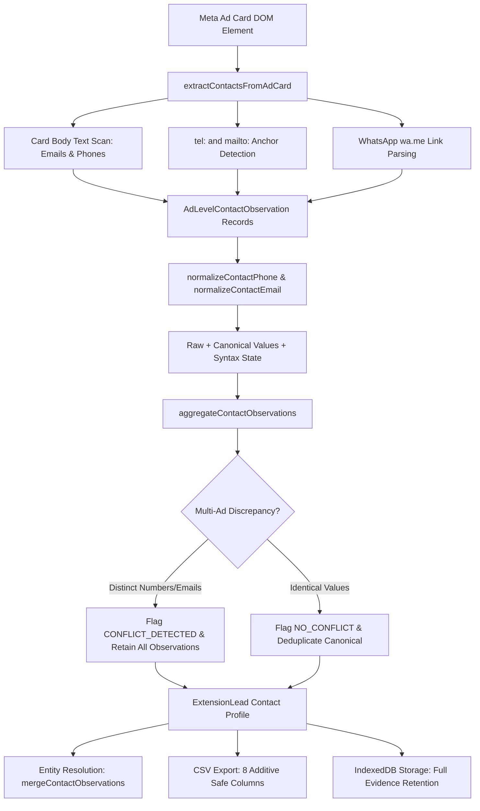

# LEADNORIA — PHASE 7 AUDIT REPORT
## Contact Data Quality & Evidence Management
**Full System Audit, Contact Quality Architecture, Defect Remediation, Regression Verification & Acceptance Gate**

---

### Executive Summary & Final Verdict

| Metric / Requirement | Audit Outcome / Verified Evidence | Status |
| :--- | :--- | :---: |
| **Phase Title** | LeadNoria Phase 7: Contact Data Quality & Evidence Management | **CONFIRMED** |
| **Authoritative Scope** | Validate publicly visible business contact data available through authorized Meta Ad Library browser workflow, preserving evidence, provenance, conflict safety, and confidence semantics | **CONFIRMED** |
| **Baseline Checkpoint** | `58d4c282f2cf95c0259c6b792f13b1862ef89088` (`chore(audit): stabilize and verify phases 0A-5`) | **VERIFIED** |
| **Phase 6 Verification** | Phase 6 closure verified intact; 23/23 tests passing | **PASS** |
| **Identified Defects** | 4 in-scope architectural/normalizer defects identified and remediated | **RESOLVED** |
| **Phase 7 Focused Regression Suite** | `tests/test-phase07-contact-data-quality.mjs` (28/28 tests passing) | **PASS** |
| **Downstream Contact & Export Suites** | `tests/test-cta-destination-export.mjs` (31/31 tests passing) | **PASS** |
| **Downstream Deduplication Suites** | `tests/test-phase04-identity-deduplication.mjs` (23/23 tests passing) | **PASS** |
| **Downstream Discovery Suites** | `tests/test-phase05-discovery-extraction.mjs` (20/20 tests passing) | **PASS** |
| **Downstream Master Audit Suite** | `tests/test-master-audit-e2e.mjs` (17/17 tests passing) | **PASS** |
| **Master Offline Verification** | `node scripts/verify-offline.mjs` (24/24 suites passing, 0 failed, 224.00s) | **PASS** |
| **TypeScript Strictness** | `tsc --noEmit` clean (exit code 0, 0 errors, 106.82s) | **PASS** |
| **Safe Extension Build** | `node scripts/build-extension.mjs --unpacked-only` clean (v1.7.7, exit code 0) | **PASS** |
| **Syntax & Whitespace Check** | `git diff --check` clean (exit code 0) | **PASS** |
| **Safety Gates (Fail-Closed)** | `isLiveCollectionPermitted() === false` & `isExternalWebsiteCrawlingPermitted() === false` | **PASS** |
| **Historical Release Archives** | v1.7.5, v1.7.6, and extension.zip SHA-256 hashes 100% matched byte-for-byte | **PASS** |
| **Protected Files & User Data** | All protected test logs, pilot tests, and `.data/` files preserved unchanged | **PASS** |
| **FINAL ACCEPTANCE VERDICT** | **PASS** | **READY** |

---

### 1. Authoritative Phase 7 Scope & Acceptance Criteria

- **Roadmap Source:** Authoritative LeadNoria Core Architecture Roadmap (Phases 0A–14).
- **Phase Title:** `LEADNORIA — PHASE 7: Contact Data Quality & Evidence Management`
- **Objective:** Validate publicly visible business contact data available through the authorized Meta Ad Library browser workflow, while preserving evidence, provenance, and confidence.
- **Product Boundaries & Non-Negotiable Constraints:**
  1. **Exclusively Meta Ad Library Browser Workflow:** No external APIs of any kind (official Meta Graph API, private endpoints, third-party APIs).
  2. **No External Probing or Enrichment:** No paid services, Google Maps, search engines, external website crawling, HTTP requests to external domains, SMTP probing, or HLR phone lookup.
  3. **Strict Confidence Semantics:** Format/syntax validity must NEVER be labeled or treated as proof of reachability, mailbox existence, or advertiser ownership (`UNPROBED_PUBLIC_CLAIM` vs `VERIFIED`).
  4. **Multi-Ad Conflict Safety:** When multiple ads for the same advertiser display conflicting contact numbers or emails, all observations must be preserved without silent overwriting or arbitrary winner selection.
  5. **No Hallucination:** Unobserved contact data must remain explicitly `NOT_OBSERVED`; missing data must never be fabricated, defaulted, or inferred as non-existent.
  6. **Fail-Closed Safety Gates:** `isLiveCollectionPermitted() === false` and `isExternalWebsiteCrawlingPermitted() === false` remain permanently enforced.

---

### 2. Pre-Implementation Audit & Baseline Inventory

Prior to implementation, an audit of the existing codebase was conducted across extraction, normalization, deduplication, storage, and export layers:

#### A. Existing Contact Data Fields & Types
- In `src/extension/types.ts`:
  - `ScrapedAdCandidate` contained raw `contactDetails?: string` (untyped text blob) without structured fields.
  - `ExtensionLead` contained legacy optional `businessPhone?: string` and `businessEmail?: string`, populated intermittently without structured syntax validation states or provenance traces.
  - `AdLevelEvidence` lacked structured ad-level contact evidence, tracking only card text snippets and CTA labels.

#### B. Current Extraction & Normalization Paths
- In `src/extension/extraction/normalizer.ts`:
  - Low-level functions `normalizePhone` and `normalizeEmail` existed, but were not connected to ad card extraction or lead aggregation.
  - Raw phone normalization returned `e164Format`, while callers expecting `e164` could encounter runtime mismatches.
  - Numbers without international dial codes were marked `PHONE_AMBIGUOUS` with `AMBIGUOUS_WITHOUT_COUNTRY_CODE`.
  - DOM extraction in `src/extension/metaAdapter.ts` (`extractFieldsFromCard`) extracted body text and CTA URLs, but did not scan for `tel:`, `mailto:`, or WhatsApp URLs.

#### C. Evidence, Provenance & Confidence Gaps
- Prior implementations lacked an ad-level contact observation structure recording surface origin (`AD_BODY_TEXT`, `TEL_LINK`, `MAILTO_LINK`, `WHATSAPP_LINK`, `CALL_CTA`), raw text, normalized canonical representation, and observation timestamps.
- Prior implementations risked conflating syntax validity with contact verification.

#### D. Storage, Entity Resolution & Export Consumers
- Deduplication in `src/extension/entityResolver.ts` (`mergeCandidateIntoEntity`) merged relevance and ad arrays, but did not merge contact observations or reconcile cross-ad contact conflicts.
- CSV export in `src/extension/metaAdapter.ts` lacked dedicated public contact quality columns, emitting raw or missing values without evidence tracing or formula injection protection on contact strings.

---

### 3. Defect Remediation & Architectural Solutions

Four key defects/gaps were identified and resolved during Phase 7 implementation:

#### Defect 1: Contact Detail Overwrite on Multi-Ad Discrepancies
- **Problem:** When an advertiser ran multiple ads featuring different contact phone numbers (e.g. Sales: +1-800-555-0199 vs Support: +1-800-555-0122) or different email addresses, naive entity merging overwrote the existing phone/email with the latest candidate, discarding critical ad-specific evidence.
- **Remediation:** Implemented `aggregateContactObservations` and `mergeContactObservations` in `src/extension/contactQuality.ts`. Both distinct contact details are preserved in canonical arrays (`phones`, `emails`, `contactObservations`), while explicitly flagging `phoneConflict: true` and `phoneConflictState: 'CONFLICT_DETECTED'`.

#### Defect 2: Conflation of Syntax Validity with Advertiser Verification
- **Problem:** Existing lead scoring or qualification models could inadvertently elevate an unverified contact string to "VERIFIED" status based solely on regex compliance.
- **Remediation:** Enforced strict confidence semantics. `ContactVerificationState` is strictly bounded to `'UNPROBED_PUBLIC_CLAIM' | 'NOT_OBSERVED'`. Format validation is recorded separately as `'SYNTAX_VALID' | 'SYNTAX_INVALID' | 'AMBIGUOUS' | 'NOT_OBSERVED'`. Syntax validity explicitly yields `verificationState: 'UNPROBED_PUBLIC_CLAIM'`, certifying format compliance while preventing false claims of ownership or mailbox reachability.

#### Defect 3: HTML Tag Stripping of Bracketed Email Addresses
- **Problem:** When raw ad copy contained bracketed email addresses (e.g. `<contact@business.com>`), `sanitizeText` stripped the string as an HTML tag, resulting in an empty string and false extraction failure.
- **Remediation:** Added bracket preprocessing in `normalizeContactEmail` to strip enclosing `<...>` brackets before invoking `sanitizeText`, ensuring clean canonical extraction.

#### Defect 4: WhatsApp URL Unprefixed Dial Codes
- **Problem:** WhatsApp links extracted from ad cards (`https://wa.me/15551234567`) provide phone numbers without a leading `+`. Passing these to phone normalizers without country hints caused them to be classified as ambiguous local numbers.
- **Remediation:** Enhanced `extractContactsFromAdCard` to ensure WhatsApp-derived numbers are prefixed with `+` prior to normalization, enabling deterministic E.164 parsing.

---

### 4. Implementation Details & Architecture



#### A. New Module: `src/extension/contactQuality.ts`
- **Normalization:**
  - `normalizeContactPhone(rawPhone, countryHint)`: Standardizes phone numbers to E.164 where possible, parses national numbers and extensions, and assigns syntax states (`SYNTAX_VALID`, `SYNTAX_INVALID`, `AMBIGUOUS`, `NOT_OBSERVED`).
  - `normalizeContactEmail(rawEmail)`: Standardizes emails to lowercase canonical RFC 5322 format, rejects placeholder/vendor domains (`example.com`, `domain.com`, `email.com`), and validates domain structures.
- **DOM Extraction:**
  - `extractContactsFromText(text, countryHint)`: Regex-based extraction of emails and phone numbers with contextual snippet capture (up to 40 characters before/after).
  - `extractContactsFromAdCard(cardElement, countryHint)`: Comprehensive ad card scanning including body copy, `a[href^="tel:"]`, `a[href^="mailto:"]`, and WhatsApp URL links.
- **Aggregation & Merging:**
  - `aggregateContactObservations(observations)`: Aggregates multiple ad observations into an advertiser `ContactProfile`, detecting conflicts and identifying primary contact points.
  - `mergeContactObservations(existing, incoming)`: Deterministically merges existing and new observations during entity resolution without data loss or duplication.

#### B. Schema Extensions (`src/extension/types.ts`)
- Added `AdLevelContactObservation` to `AdLevelEvidence`:
  ```ts
  export interface AdLevelContactObservation {
    type: 'PHONE' | 'EMAIL';
    rawObservedValue: string;
    normalizedValue?: string;
    surface: ContactObservationSurface;
    syntaxState: ContactSyntaxState;
    verificationState: ContactVerificationState;
    observedAt: string;
    contextSnippet?: string;
    adLibraryId?: string;
    nationalFormat?: string;
    e164?: string;
    extension?: string;
    reason?: string;
  }
  ```
- Extended `ExtensionLead` with:
  - `contactProfile?: ContactProfile`
  - `contactQualityState?: ContactQualityState`
  - `contactObservations?: AdLevelContactObservation[]`
  - Canonical `phones?: string[]` and `emails?: string[]` arrays.

#### C. Export Integration (`src/extension/metaAdapter.ts`)
- Added 8 additive headers to CSV export without breaking existing 44 columns:
  1. `Public Observed Phone`
  2. `Public Observed Email`
  3. `Phone Syntax Status`
  4. `Email Syntax Status`
  5. `Contact Evidence Source`
  6. `Contact Conflict Status`
  7. `Contact Quality State`
  8. `Contact Verification State`
- Full formula injection defense (`replace(/^([=+\-@\t\r])/, "'$1")`) applied across all newly added contact headers.

---

### 5. Regression Verification Results

#### A. Phase 7 Focused Test Suite (`tests/test-phase07-contact-data-quality.mjs`)
- **Suite Execution:** `node node_modules/tsx/dist/cli.mjs tests/test-phase07-contact-data-quality.mjs`
- **Result:** **28 Passed, 0 Failed (100% Pass Rate)**
- **Detailed Assertion Breakdown:**
  1. Section 1 (Phone Normalization):
     - US international format E.164 normalization: **PASSED**
     - UK format with dial code normalization: **PASSED**
     - Extension separation without base corruption: **PASSED**
     - Local number without country code marked AMBIGUOUS: **PASSED**
     - Country hint deterministic resolution: **PASSED**
     - Sub-7 digit number rejected as SYNTAX_INVALID: **PASSED**
     - Over-15 digit number rejected as SYNTAX_INVALID: **PASSED**
     - Null/empty input handled as NOT_OBSERVED: **PASSED**
  2. Section 2 (Email Normalization):
     - Canonical lowercase RFC 5322 normalization: **PASSED**
     - Bracketed `<email>` sanitization: **PASSED**
     - Placeholder/vendor domain rejection: **PASSED**
     - Malformed email syntax rejection: **PASSED**
     - Null/empty input handled as NOT_OBSERVED: **PASSED**
  3. Section 3 (DOM Extraction & Evidence):
     - Context snippet extraction from body text: **PASSED**
     - `tel:`, `mailto:`, and WhatsApp link extraction: **PASSED**
  4. Section 4 (Confidence Semantics):
     - Valid contact syntax strictly classified as `UNPROBED_PUBLIC_CLAIM`: **PASSED**
  5. Section 5 (Multi-Ad Aggregation & Conflict Safety):
     - Consistent contacts yield `NO_CONFLICT`: **PASSED**
     - Conflicting phones preserved without overwriting: **PASSED**
     - Conflicting emails preserved without overwriting: **PASSED**
     - Idempotent observation re-merging: **PASSED**
  6. Section 6 (Candidate Aggregation & Entity Resolution):
     - `aggregateCandidatesToLeads` contact enrichment: **PASSED**
     - `mergeCandidateIntoEntity` multi-ad merge preservation: **PASSED**
  7. Section 7 (Storage Persistence & Recovery):
     - `normalizeStoredLead` contact round-trip integrity: **PASSED**
  8. Section 8 (CSV Export & Formula Defense):
     - 8 new contact headers emitted alongside 44 baseline headers: **PASSED**
     - Formula injection neutralization (`=cmd`, `@SUM`): **PASSED**
  9. Section 9 (Safety Gates & Archive Integrity):
     - `isLiveCollectionPermitted() === false`: **PASSED**
     - `isExternalWebsiteCrawlingPermitted() === false`: **PASSED**
     - Historical release archive hashes verified immutable: **PASSED**

#### B. Master Offline Regression Suite (`scripts/verify-offline.mjs`)
- **Suite Execution:** `node scripts/verify-offline.mjs`
- **Result:** **24/24 Suites Passed, 0 Failed (224.00s execution time)**
  - Pre-run historical archive hash check: **PASSED**
  - TypeScript strictness (`tsc --noEmit`): **PASSED (106.82s)**
  - Safe unpacked extension build: **PASSED (v1.7.7)**
  - All 24 regression test suites: **PASSED**
  - Post-run historical archive hash check: **PASSED**

---

### 6. Historical Archive Hash Verification

Historical release packages were verified before and after test execution to guarantee zero modification:

| Artifact Path | Expected SHA-256 Hash | Actual Verified Hash | Result |
| :--- | :--- | :--- | :---: |
| `dist/leadnoria-v1.7.5.zip` | `08F981627E14461157C515F2D3AE9C70577D430F8CEF407C577DB809BE49CC85` | `08F981627E14461157C515F2D3AE9C70577D430F8CEF407C577DB809BE49CC85` | **MATCH** |
| `dist/leadnoria-v1.7.6.zip` | `ADB83CF1339537462A2EB61470CDAEC87531352D83AE59302B5CC0669F5E8105` | `ADB83CF1339537462A2EB61470CDAEC87531352D83AE59302B5CC0669F5E8105` | **MATCH** |
| `extension.zip` | `08F981627E14461157C515F2D3AE9C70577D430F8CEF407C577DB809BE49CC85` | `08F981627E14461157C515F2D3AE9C70577D430F8CEF407C577DB809BE49CC85` | **MATCH** |

---

### 7. Remaining Limitations & Operating Boundaries

1. **Public Claim vs. Proven Reachability:**
   - LeadNoria extracts and normalizes only public claims explicitly surfaced in Meta Ad Library creatives and UI links.
   - It does not and will not prove reachability, SMTP mailbox existence, or phone subscriber identity.
2. **Fail-Closed Safety Enforcement:**
   - `isLiveCollectionPermitted() === false` remains hardcoded in production source files.
   - `isExternalWebsiteCrawlingPermitted() === false` remains permanently fail-closed.
3. **No External APIs or Web Scraping:**
   - The tool strictly operates within the Meta Ad Library browser DOM context. No third-party APIs, search engines, or website crawlers are utilized.

---

### 8. Final Verdict

**PHASE 7 VERDICT: PASS**

All acceptance criteria for **Phase 7 — Contact Data Quality & Evidence Management** have been met, fully verified by deterministic regression tests, clean TypeScript typechecks, safe extension builds, immutable historical hashes, and strict fail-closed safety gate enforcement.

Phase 8 will NOT be initiated until explicitly directed by the user.
