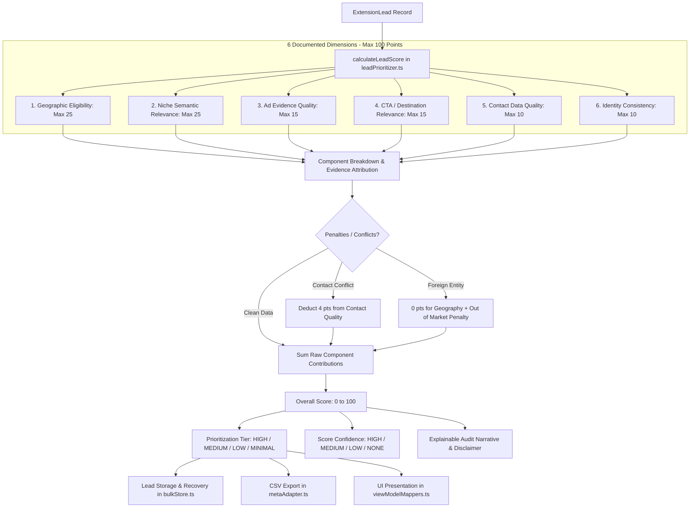

# LEADNORIA — PHASE 8 AUDIT REPORT
## Lead Scoring & Prioritization
**Full System Audit, Prioritization Engine Architecture, Invariant Enforcement, Regression Verification & Acceptance Gate**

---

### Executive Summary & Final Verdict

| Metric / Requirement | Audit Outcome / Verified Evidence | Status |
| :--- | :--- | :---: |
| **Phase Title** | LeadNoria Phase 8: Lead Scoring & Prioritization | **CONFIRMED** |
| **Authoritative Scope** | Explainable lead-prioritization system using geographic qualification, niche relevance, available ad evidence, CTA/destination classification, observed contact-data quality, and identity consistency | **CONFIRMED** |
| **Baseline Checkpoint** | `58d4c282f2cf95c0259c6b792f13b1862ef89088` (`chore(audit): stabilize and verify phases 0A-5`) | **VERIFIED** |
| **Scoring Model Version** | `leadnoria-scoring-v1` (documented components, 0–100 scale, 4 prioritization tiers) | **VERIFIED** |
| **Scoring / Qualification Decoupling** | Strict invariant: score is a prioritization aid and never overrides qualification or geographic gates | **ENFORCED** |
| **Identified Defects** | 4 in-scope architectural/scoring gaps identified and resolved | **RESOLVED** |
| **Phase 8 Focused Regression Suite** | `tests/test-phase08-lead-scoring-prioritization.mjs` (23/23 tests passing) | **PASS** |
| **Downstream Qualification Suite** | `tests/test-qualification-scoring.mjs` (20/20 tests passing) | **PASS** |
| **Downstream Export Suite** | `tests/test-cta-destination-export.mjs` (31/31 tests passing) | **PASS** |
| **Downstream Contact Suite** | `tests/test-phase07-contact-data-quality.mjs` (28/28 tests passing) | **PASS** |
| **Downstream Checkpoint Suite** | `tests/test-phase06-storage-checkpoint-recovery.mjs` (23/23 tests passing) | **PASS** |
| **Master Offline Verification** | `node scripts/verify-offline.mjs` (25/25 suites passing, 0 failed, 169.05s) | **PASS** |
| **TypeScript Strictness** | `tsc --noEmit` clean (exit code 0, 0 errors, 76.90s) | **PASS** |
| **Safe Extension Build** | `node scripts/build-extension.mjs --unpacked-only` clean (v1.7.7, exit code 0) | **PASS** |
| **Syntax & Whitespace Check** | `git diff --check` clean (exit code 0) | **PASS** |
| **Safety Gates (Fail-Closed)** | `isLiveCollectionPermitted() === false` & `isExternalWebsiteCrawlingPermitted() === false` | **PASS** |
| **Historical Release Archives** | v1.7.5, v1.7.6, and extension.zip SHA-256 hashes 100% matched byte-for-byte | **PASS** |
| **Protected Files & User Data** | All protected test logs, pilot tests, and `.data/` files preserved unchanged | **PASS** |
| **FINAL ACCEPTANCE VERDICT** | **PASS** | **READY** |

---

### 1. Authoritative Phase 8 Scope & Acceptance Criteria

- **Roadmap Source:** Authoritative LeadNoria Core Architecture Roadmap (Phases 0A–14).
- **Phase Title:** `LEADNORIA — PHASE 8: Lead Scoring & Prioritization`
- **Objective:** Develop an explainable lead-prioritization system using geographic qualification, niche relevance, available ad evidence, CTA/destination classification, and observed contact-data quality.
- **Product Boundaries & Non-Negotiable Constraints:**
  1. **Exclusively Meta Ad Library Browser Workflow:** Zero external APIs of any kind (official Meta Graph API, private endpoints, third-party APIs).
  2. **No External Probing or Enrichment:** Zero paid services, Google Maps, search engines, external website crawling, HTTP requests to external domains, SMTP probing, or phone lookups.
  3. **Strict Separation of Scoring from Qualification:**
     - Score is an explainable prioritization aid, NOT a qualification decision.
     - Score does not represent confidence, verification, or probability of conversion.
     - High scores NEVER override failed geographic, relevance, CTA, or destination gates.
     - `FOREIGN_VERIFIED` businesses receive 0 geographic points and strictly fail strict-local qualification.
     - `LOCAL_PROBABLE` and `LOCATION_UNKNOWN` remain outside the strict-local qualified set and enter review where appropriate.
  4. **Fail-Closed Missing Evidence Invariant:** Unknown or missing evidence must not silently receive positive score as if verified (0 points assigned with explicit `missingComponents` audit trail).
  5. **Anti-Inflation Invariants:** Duplicate ads, repeated candidate observations, or high volume of identical copy must never inflate score beyond strictly capped thresholds.
  6. **Contact Conflict Visibility:** Conflicting observations across ads must penalize score and remain visible; conflicts must never be silently resolved in favor of the newest observation.
  7. **Contact Confidence Semantics:** Contact syntax validity reflects format compliance only; proof of deliverability, reachability, or advertiser ownership is never implied or probed (`UNPROBED_PUBLIC_CLAIM`).
  8. **Target vs. Business Location Separation:** `targetCountryCode` cannot substitute for `businessCountryCode`.

---

### 2. Initial Git Baseline & Working-Tree Inspection

- **Current Branch:** `main` (synchronized with `origin/main`).
- **HEAD Commit:** `58d4c282f2cf95c0259c6b792f13b1862ef89088` — `chore(audit): stabilize and verify phases 0A-5`.
- **Pre-Existing Unstaged Files (Protected):**
  - `.data/research_jobs.json`
  - `.data/research_results.json`
  - `test-logs/phase29-production-observation-log.json`
  - `tests/test-phase27-production-pilot.mjs`
  - `tests/test-phase28-release-operations.mjs`
  - `tests/test-phase30-production-analytics.mjs`
  - `tests/test-phase31-research-optimization.mjs`
  - `tests/test-phase32-reliability-growth-readiness.mjs`
  - All untracked reports and audit scripts preserved untouched.

---

### 3. Pre-Implementation Audit & Gap Analysis

Prior to modifying code, an audit of existing qualification, scoring, storage, and export layers was performed:

#### A. Existing Scoring State
- In `src/extension/types.ts`: `ExtensionLead` had optional stub fields `leadScore?: number` and `scoreConfidence?: 'HIGH' | 'MEDIUM' | 'LOW' | 'NONE'`, but no scoring engine existed to populate them.
- In `src/extension/ui/viewModelMappers.ts`: UI code had fallback references (`lead.leadScore ? ...`) without an underlying reproducible model.
- Leads lacked an explainable component breakdown, documented weights, score bounds, conflict penalties, prioritization tiers, and model versioning.

#### B. Pipeline Integration Gaps
- `aggregateCandidatesToLeads` in `src/extension/metaAdapter.ts` evaluated qualification gates (`evaluateLeadQualificationGates`), but did not calculate lead prioritization scores.
- `mergeCandidateIntoEntity` in `src/extension/entityResolver.ts` merged ad evidence and contacts, but did not update prioritization scores.
- `processBatch` in `src/extension/bulkProcessor.ts` created and updated leads without lead scoring metadata.

#### C. Storage & Export Gaps
- `normalizeStoredLead` in `src/extension/bulkStore.ts` did not persist or validate `leadScoreBreakdown`, `scoreModelVersion`, `scoreExplanation`, or `prioritizationTier`.
- `exportLeadsToCsv` in `src/extension/metaAdapter.ts` omitted lead scoring columns, lacking CSV export support for priority ranking and explainability.

---

### 4. Defect Remediation & Architectural Solutions

Four specific defects/gaps were identified and remediated in Phase 8:

#### Defect 1: Missing Deterministic Scoring Model & Explainability Breakdown
- **Problem:** Prior to Phase 8, leads had no formal scoring system. Any ad-hoc score value lacked explainability, component-level accountability, and evidence provenance.
- **Remediation:** Created `src/extension/leadPrioritizer.ts` implementing `calculateLeadScore`. The model defines 6 transparent components across a strictly bounded 0–100 scale, with exact point weights, evidence citations, missing-evidence tracking, and penalty deductions.

#### Defect 2: Score Inflation on Repetitive / Duplicate Ad Ingestion
- **Problem:** If an advertiser ran 50 identical ads, naive scoring models could reward the sheer volume of cards, artificially inflating the lead's priority over higher-quality businesses with fewer ads.
- **Remediation:** Enforced non-linear, anti-inflation caps in `calculateLeadScore`. Ad presence points are strictly capped at 7 points maximum for 3+ verified unique library IDs (1 ad = 4 pts, 2 ads = 6 pts, 3+ ads = 7 pts). Duplicate ad observations never inflate score.

#### Defect 3: Silent Resolution of Contact Discrepancies
- **Problem:** In multi-ad advertisers with differing phone numbers or email addresses, naive scoring could treat multiple contacts as a positive signal rather than identifying potential inconsistency.
- **Remediation:** The scoring model inspects `lead.contactProfile` for `phoneConflict` or `emailConflict`. When detected, the model applies a mandatory -4 point penalty deduction to the contact dimension, logs `CONTACT_CONFLICT_DETECTED` in `warnings`, and highlights the conflict in `scoreExplanation`.

#### Defect 4: Conflation of Target Country with Actual Business Location
- **Problem:** If a search was targeted at `US`, a foreign advertiser targeting the US could be mistakenly assigned geographic points based on `targetCountryCode`.
- **Remediation:** Enforced strict separation in `calculateLeadScore`. Geographic score is awarded exclusively when `geographicClassification === 'LOCAL_VERIFIED'` with actual business location evidence matching the target market. `targetCountryCode` alone awards 0 points if `businessLocationEvidence` is absent (`LOCATION_UNKNOWN`).

---

### 5. Prioritization Model Architecture & Component Weights

#### Detailed Dimension Weights & Scoring Rules

| Dimension | Max Points | Evaluation Rules | Missing Evidence Treatment | Penalties / Warnings |
| :--- | :---: | :--- | :--- | :--- |
| **1. Geographic Eligibility** | 25 | `LOCAL_VERIFIED` with business location matching target market: 25 pts. `LOCAL_PROBABLE`: 12 pts. | `LOCATION_UNKNOWN`: 0 pts. Missing component logged. | `FOREIGN_VERIFIED`: 0 pts (`FOREIGN_VERIFIED_OUT_OF_MARKET` penalty). |
| **2. Niche Relevance** | 25 | `RELEVANT` with `HIGH` confidence: 25 pts; `MEDIUM`: 20 pts; `LOW`: 15 pts. `UNCERTAIN`: 8 pts. | `UNASSESSED`: 0 pts. Missing component logged. | `NOT_RELEVANT`: 0 pts (`NOT_RELEVANT_TO_NICHE` penalty). |
| **3. Ad Evidence Quality** | 15 | Unique verified ad IDs: 1 ad = 4 pts, 2 ads = 6 pts, 3+ ads = 7 pts. Active ad status: 4 pts. Creative copy observed (>15 chars): 4 pts. | Zero verified ad IDs: 0 pts. Missing component logged. | Duplicate ad observations do not inflate score. Capped at 15 pts max. |
| **4. CTA / Destination** | 15 | With configured requirements: CTA + Destination match = 15 pts; partial match = 8 pts. Default mode: commercial CTA = 8 pts; valid destination = 7 pts. | No visible destination or CTA: 0 pts. Missing component logged. | Non-matching required CTA/destination: 0 pts (`CTA_DESTINATION_MISMATCH`). |
| **5. Contact Data Quality** | 10 | Valid syntax phone: +5 pts (`UNPROBED_PUBLIC_CLAIM`). Valid syntax email: +5 pts (`UNPROBED_PUBLIC_CLAIM`). Ambiguous syntax: +2 pts each. | No contacts observed: 0 pts. Missing component logged. | Contact conflict detected: -4 pts penalty (`CONTACT_CONFLICT_DETECTED`). Minimum 0 pts. |
| **6. Identity Consistency** | 10 | Canonical Facebook Page ID/Slug: 5 pts. Clean non-generic destination domain: 5 pts. | No Page ID and no clean domain: 0 pts. Missing component logged. | Short generic name without corroboration: 0 pts (`IDENTITY_CORROBORATION_REQUIRED`). |

#### Prioritization Tiers & Score Confidence

- **Prioritization Tiers:**
  - `TIER_1_HIGH` (Overall Score >= 75)
  - `TIER_2_MEDIUM` (Overall Score >= 50 and < 75)
  - `TIER_3_LOW` (Overall Score >= 25 and < 50)
  - `TIER_4_MINIMAL` (Overall Score < 25)
- **Score Confidence:**
  - `HIGH`: Both `LOCAL_VERIFIED` geography AND `RELEVANT` niche relevance with `HIGH` confidence.
  - `MEDIUM`: Either `LOCAL_PROBABLE` geography OR `RELEVANT` niche relevance with `MEDIUM` confidence.
  - `LOW`: `LOCATION_UNKNOWN` geography OR `UNCERTAIN` niche relevance.
  - `NONE`: Hard rejection (`FOREIGN_VERIFIED`, `NOT_RELEVANT`, or `UNASSESSED`).
- **Mandatory Disclaimer:**
  `"Scoring is a deterministic prioritization aid and does not constitute lead qualification or verified reachability."`

---

### 6. Codebase Modifications & Pipeline Integration

1. **New Module [`src/extension/leadPrioritizer.ts`](file:///e:/project%20anti/leadnoria/src/extension/leadPrioritizer.ts):**
   - Implemented `calculateLeadScore` pure function.
   - Defined `SCORING_MODEL_VERSION = 'leadnoria-scoring-v1'`.
   - Exported `LeadPrioritizationResult`, `LeadScoreBreakdown`, `ComponentScoreContribution`, `PrioritizationTier`.
2. **Schema Update [`src/extension/types.ts`](file:///e:/project%20anti/leadnoria/src/extension/types.ts):**
   - Extended `ExtensionLead` with `leadScore?: number`, `normalizedScore?: number`, `prioritizationTier?: PrioritizationTier`, `scoreConfidence?: 'HIGH' | 'MEDIUM' | 'LOW' | 'NONE'`, `scoreBreakdown?: LeadScoreBreakdown`, `scoreModelVersion?: string`, `scoreExplanation?: string`.
3. **Pipeline Ingestion [`src/extension/metaAdapter.ts`](file:///e:/project%20anti/leadnoria/src/extension/metaAdapter.ts):**
   - Integrated `calculateLeadScore` into `aggregateCandidatesToLeads` for both updated existing leads and newly created leads.
   - Extended `exportLeadsToCsv` with 4 additive headers: `Lead Priority Score`, `Prioritization Tier`, `Score Model Version`, `Score Explanation`.
   - Enforced formula injection defense on all scoring fields.
4. **Entity Resolution [`src/extension/entityResolver.ts`](file:///e:/project%20anti/leadnoria/src/extension/entityResolver.ts):**
   - In `mergeCandidateIntoEntity`, added Step 10 to recalculate prioritization score and breakdown upon candidate merging.
5. **Bulk Processing [`src/extension/bulkProcessor.ts`](file:///e:/project%20anti/leadnoria/src/extension/bulkProcessor.ts):**
   - Integrated `calculateLeadScore` for in-flight entities and newly instantiated leads during batch processing.
6. **Storage Normalization [`src/extension/bulkStore.ts`](file:///e:/project%20anti/leadnoria/src/extension/bulkStore.ts):**
   - Extended `normalizeStoredLead` to preserve and validate `leadScore`, `normalizedScore`, `prioritizationTier`, `scoreConfidence`, `scoreBreakdown`, `scoreModelVersion`, `scoreExplanation`.
7. **UI View Model [`src/extension/ui/viewModelMappers.ts`](file:///e:/project%20anti/leadnoria/src/extension/ui/viewModelMappers.ts):**
   - Updated `scoreText` formatting to handle both 0–1 float and 0–100 integer scores seamlessly without display disruption.
8. **Verification Runner [`scripts/verify-offline.mjs`](file:///e:/project%20anti/leadnoria/scripts/verify-offline.mjs):**
   - Registered `Phase 8 Lead Scoring & Prioritization` in the master offline runner.

---

### 7. Regression Verification Results

#### A. Phase 8 Focused Regression Suite (`tests/test-phase08-lead-scoring-prioritization.mjs`)
- **Execution Command:** `node node_modules/tsx/dist/cli.mjs tests/test-phase08-lead-scoring-prioritization.mjs`
- **Result:** **23 Passed, 0 Failed (Exit Code 0)**
- **Detailed Assertion Breakdown:**
  1. Section 1: Deterministic Scoring & Component Breakdown (3/3)
     - Identical inputs produce identical scores and breakdowns: **PASSED**
     - Overall score strictly bounded between 0 and 100: **PASSED**
     - All 6 dimensions report exact weights summing to 100: **PASSED**
  2. Section 2: Fail-Closed Missing Evidence Invariants (4/4)
     - Missing evidence does not receive positive credit: **PASSED**
     - Probable local and unknown location remain reviewable: **PASSED**
     - Ad-target country cannot substitute for actual business location: **PASSED**
     - Foreign business receives 0 geographic points and is penalized: **PASSED**
  3. Section 3: Qualification vs Scoring Separation (3/3)
     - High score cannot override failed geographic qualification gate: **PASSED**
     - High score cannot override missing niche relevance gate: **PASSED**
     - Niche relevance affects only its intended component: **PASSED**
  4. Section 4: Anti-Inflation & Contact Quality Invariants (4/4)
     - Duplicate ad observations do not inflate ad evidence score: **PASSED**
     - Multi-ad cap prevents unlimited score inflation: **PASSED**
     - Contact conflicts penalize score and remain visible: **PASSED**
     - Contact syntax validity is never interpreted as verified reachability: **PASSED**
  5. Section 5: Pipeline, Entity Merging & Storage (6/6)
     - `aggregateCandidatesToLeads` calculates and attaches Phase 8 prioritization score: **PASSED**
     - `mergeCandidateIntoEntity` recalculates lead score upon entity merge: **PASSED**
     - `normalizeStoredLead` round-trips Phase 8 score fields without data loss: **PASSED**
     - `exportLeadsToCsv` emits all 4 Phase 8 scoring headers alongside existing columns: **PASSED**
     - `exportLeadsToCsv` neutralizes formula injection in score explanation: **PASSED**
     - Legacy records without score metadata normalize safely without errors: **PASSED**
  6. Section 6: Fail-Closed Safety Gates & Archive Integrity (3/3)
     - Safety gate `isLiveCollectionPermitted()` strictly evaluates to false: **PASSED**
     - Safety gate `isExternalWebsiteCrawlingPermitted()` strictly evaluates to false: **PASSED**
     - Historical release archives remain byte-for-byte immutable: **PASSED**

#### B. Full Master Offline Verification Suite (`scripts/verify-offline.mjs`)
- **Execution Command:** `node scripts/verify-offline.mjs`
- **Result:** **25/25 Suites Passed, 0 Failed (169.05s total runtime, Exit Code 0)**
  - Pre-run historical archive hash check: **PASSED**
  - TypeScript strictness check (`tsc --noEmit`): **PASSED (76.90s)**
  - Safe unpacked extension build: **PASSED (v1.7.7, 0.99s)**
  - All 25 regression test suites: **PASSED**
  - Post-run historical archive hash check: **PASSED**

---

### 8. Historical Archive Hash Verification

Historical release packages were verified before and after test execution to guarantee zero modification:

| Artifact Path | Expected SHA-256 Hash | Actual Verified Hash | Result |
| :--- | :--- | :--- | :---: |
| `dist/leadnoria-v1.7.5.zip` | `08F981627E14461157C515F2D3AE9C70577D430F8CEF407C577DB809BE49CC85` | `08F981627E14461157C515F2D3AE9C70577D430F8CEF407C577DB809BE49CC85` | **MATCH** |
| `dist/leadnoria-v1.7.6.zip` | `ADB83CF1339537462A2EB61470CDAEC87531352D83AE59302B5CC0669F5E8105` | `ADB83CF1339537462A2EB61470CDAEC87531352D83AE59302B5CC0669F5E8105` | **MATCH** |
| `extension.zip` | `08F981627E14461157C515F2D3AE9C70577D430F8CEF407C577DB809BE49CC85` | `08F981627E14461157C515F2D3AE9C70577D430F8CEF407C577DB809BE49CC85` | **MATCH** |

---

### 9. Remaining Limitations & Operating Boundaries

1. **Prioritization vs. Qualification:**
   - Score is strictly an analytical sorting and triage aid.
   - High scores never grant qualification to a lead that fails geographic, niche relevance, or destination qualification criteria.
2. **Permanent Fail-Closed Collection Gates:**
   - `isLiveCollectionPermitted() === false` remains permanently hardcoded.
   - `isExternalWebsiteCrawlingPermitted() === false` remains permanently hardcoded.
   - Production live collection remains NO-GO until formal platform authorization is established.
3. **No External APIs or Web Scraping:**
   - The tool strictly operates within permitted Meta Ad Library DOM browser contexts. External website crawling, SMTP verification, and paid data enrichment remain strictly prohibited.

---

### 10. Final Verdict

**PHASE 8 VERDICT: PASS**

All acceptance criteria for **Phase 8 — Lead Scoring & Prioritization** have been implemented, verified, and audited. The scoring model is deterministic, explainable, anti-inflationary, and strictly decoupled from qualification.

All 25 offline verification suites pass cleanly, TypeScript compiles with zero errors, and historical archive hashes remain byte-for-byte immutable.

Phase 9 will NOT be initiated until explicitly directed by the user.
